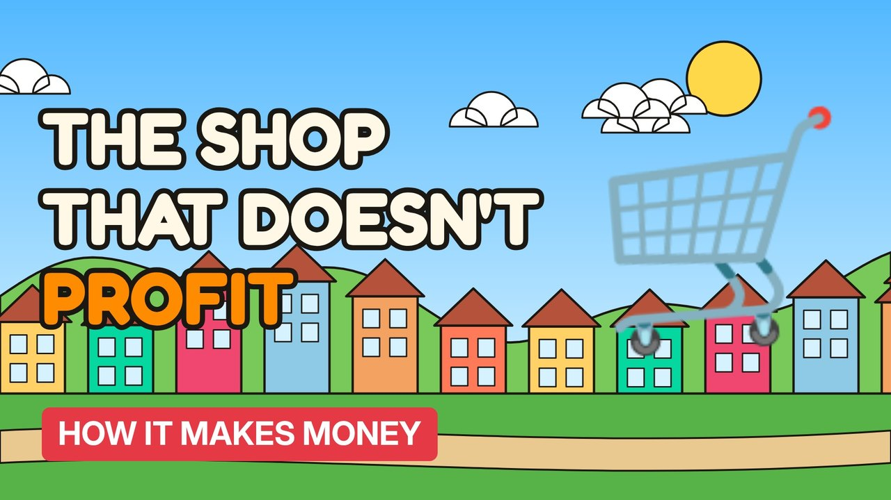

# MV001 · How Costco Makes Money (It's Not the Shopping)



## Paste this to Claude

```
Make video MV001 from my idea bank: write and fact-check the full 5+ minute script, render it in its style, and send it to me.
```

**Category:** How it makes money  
**Editing style:** Cartoon town. Flat 2D cartoon characters in a colourful painted town with ink outlines and speech bubbles. Daylight while the story is set up, then night-blue lighting for the explanation.  
**Length:** 6 to 8 minutes (about 1,000 to 1,300 words)

## Hook (first line)

> Costco barely profits from the things it sells, and that's exactly why it's one of the most successful shops on Earth.

## Outline

1. The membership fee is the real product
2. Why margins on goods are kept tiny on purpose
3. The hot dog price that hasn't changed in decades
4. Bulk buying, few products, warehouse shelves
5. Why members keep renewing
6. What UK shops could learn

## YouTube title

How Costco Makes Money (It's Not the Shopping)

## YouTube description

```
Costco barely profits from the things it sells, and that's exactly why it's one of the most successful shops on Earth.

In this video:
- The membership fee is the real product
- Why margins on goods are kept tiny on purpose
- The hot dog price that hasn't changed in decades
- Bulk buying, few products, warehouse shelves
- Why members keep renewing
- What UK shops could learn

Sources are listed here once the script has been fact-checked.
This video is for education and entertainment only and is not financial advice.

#money #businessmodel #howitmakesmoney
```

## Tags

business model, how it makes money, business explained, how costco makes money (it's not the shopping), costco, makes, money, it's, money explained

## Facts to check before scripting

- Share of Costco operating income from membership fees
- Hot dog combo price and how long it's been unchanged
- Membership renewal rate

## Script approach

Story formula: open on a paradox stated as fact (no intro), set the scene with a named everyday character, escalate in 3 to 5 beats with short dialogue in speech bubbles, then pivot with 'You see,' into the real explanation (lighting turns night-blue) and land on an ironic last line.
