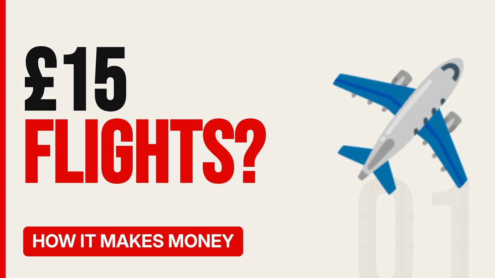

# MV002 · How Ryanair Makes Money on £15 Flights



## Paste this to Claude

```
Make video MV002 from my idea bank: write and fact-check the full 5+ minute script, render it in its style, and send it to me.
```

**Category:** How it makes money  
**Editing style:** Bold minimal. Off-white page, giant condensed capitals, black and red only. Hard, punchy cuts on the beat.  
**Length:** 6 to 8 minutes (about 1,000 to 1,300 words)

## Hook (first line)

> Ryanair sells some seats for less than a taxi to the airport, and still makes hundreds of millions in profit.

## Outline

1. The ticket is the bait
2. Bags, seats, priority and the extras
3. Fast turnarounds and one type of plane
4. Cheap airports and airport deals
5. Fuel hedging and buying planes in bulk
6. Is it a good deal for you?

## YouTube title

How Ryanair Makes Money on £15 Flights

## YouTube description

```
Ryanair sells some seats for less than a taxi to the airport, and still makes hundreds of millions in profit.

In this video:
- The ticket is the bait
- Bags, seats, priority and the extras
- Fast turnarounds and one type of plane
- Cheap airports and airport deals
- Fuel hedging and buying planes in bulk
- Is it a good deal for you?

Sources are listed here once the script has been fact-checked.
This video is for education and entertainment only and is not financial advice.

#money #businessmodel #howitmakesmoney
```

## Tags

business model, how it makes money, business explained, how ryanair makes money on £15 flights, ryanair, makes, money, flights, money explained

## Facts to check before scripting

- Latest annual profit
- Share of revenue from ancillaries
- Typical turnaround time

## Script approach

Script formula: the hook is the first sentence (no intro), then 4 to 6 chapters, each opening with a question the viewer wants answered. Keep sentences short and spoken. Close every chapter with a mini-cliffhanger into the next, and end on a one-line takeaway.
