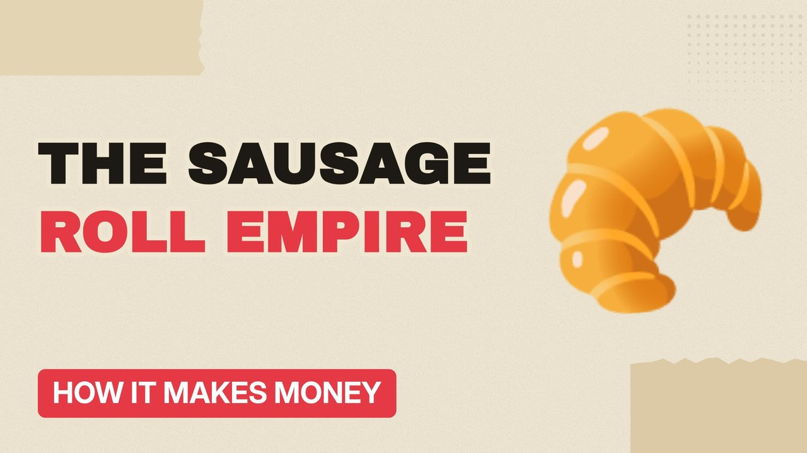

# MV003 · How Greggs Got So Profitable Selling Sausage Rolls



## Paste this to Claude

```
Make video MV003 from my idea bank: write and fact-check the full 5+ minute script, render it in its style, and send it to me.
```

**Category:** How it makes money  
**Editing style:** Paper collage. Cream paper, torn cut-outs, red marker colours and heavy type. Each new scene slaps down like a card on a table.  
**Length:** 6 to 8 minutes (about 1,000 to 1,300 words)

## Hook (first line)

> A bakery chain built on cheap sausage rolls is now worth billions of pounds. Here's how.

## Outline

1. From one Newcastle bakery to thousands of shops
2. Making everything in its own factories
3. Volume over margin
4. The vegan sausage roll moment
5. Late-night, drive-thru and delivery
6. The risks ahead

## YouTube title

How Greggs Got So Profitable Selling Sausage Rolls

## YouTube description

```
A bakery chain built on cheap sausage rolls is now worth billions of pounds. Here's how.

In this video:
- From one Newcastle bakery to thousands of shops
- Making everything in its own factories
- Volume over margin
- The vegan sausage roll moment
- Late-night, drive-thru and delivery
- The risks ahead

Sources are listed here once the script has been fact-checked.
This video is for education and entertainment only and is not financial advice.

#money #businessmodel #howitmakesmoney
```

## Tags

business model, how it makes money, business explained, how greggs got so profitable selling sausage rolls, greggs, profitable, selling, sausage, money explained

## Facts to check before scripting

- Number of shops
- Latest annual sales and profit
- Vegan sausage roll launch year (2019)

## Script approach

Script formula: the hook is the first sentence (no intro), then 4 to 6 chapters, each opening with a question the viewer wants answered. Keep sentences short and spoken. Close every chapter with a mini-cliffhanger into the next, and end on a one-line takeaway.
