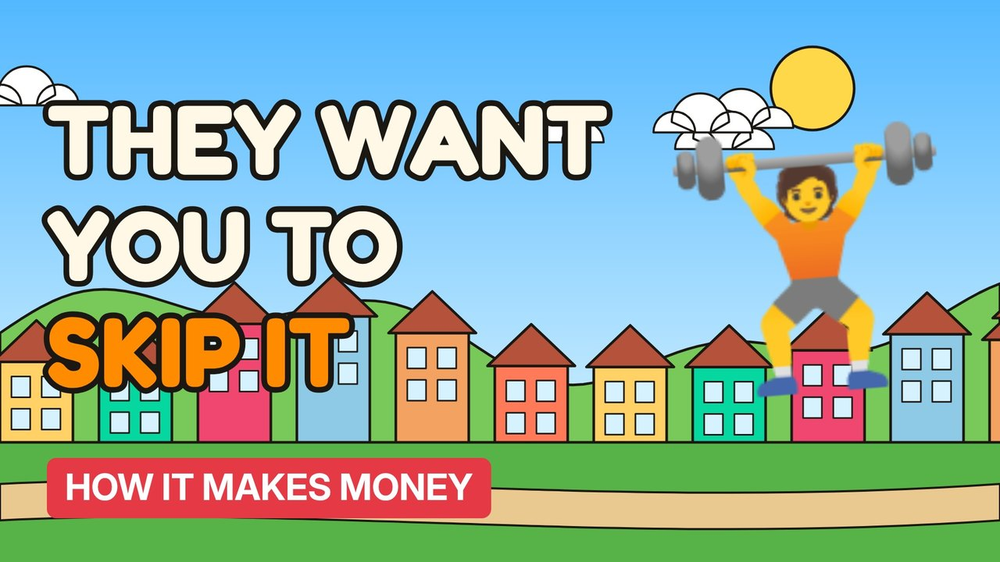

# MV004 · How Gyms Make Money From People Who Never Go



## Paste this to Claude

```
Make video MV004 from my idea bank: write and fact-check the full 5+ minute script, render it in its style, and send it to me.
```

**Category:** How it makes money  
**Editing style:** Cartoon town. Flat 2D cartoon characters in a colourful painted town with ink outlines and speech bubbles. Daylight while the story is set up, then night-blue lighting for the explanation.  
**Length:** 6 to 8 minutes (about 1,000 to 1,300 words)

## Hook (first line)

> Your gym makes the most money from you if you never turn up.

## Outline

1. The membership model explained
2. Why gyms sign up far more people than fit inside
3. January sign-ups and the long tail
4. Cancellation friction
5. Budget gyms vs boutique studios
6. How to use it in your favour

## YouTube title

How Gyms Make Money From People Who Never Go

## YouTube description

```
Your gym makes the most money from you if you never turn up.

In this video:
- The membership model explained
- Why gyms sign up far more people than fit inside
- January sign-ups and the long tail
- Cancellation friction
- Budget gyms vs boutique studios
- How to use it in your favour

Sources are listed here once the script has been fact-checked.
This video is for education and entertainment only and is not financial advice.

#money #businessmodel #howitmakesmoney
```

## Tags

business model, how it makes money, business explained, how gyms make money from people who never go, gyms, make, money, from, money explained

## Facts to check before scripting

- Typical members per gym vs capacity
- Share of members who rarely attend (cite a study)

## Script approach

Story formula: open on a paradox stated as fact (no intro), set the scene with a named everyday character, escalate in 3 to 5 beats with short dialogue in speech bubbles, then pivot with 'You see,' into the real explanation (lighting turns night-blue) and land on an ironic last line.
