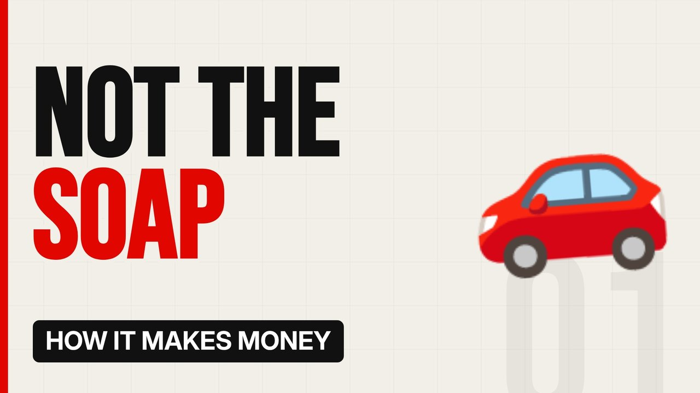

# MV005 · How Car Washes Really Make Money



## Paste this to Claude

```
Make video MV005 from my idea bank: write and fact-check the full 5+ minute script, render it in its style, and send it to me.
```

**Category:** How it makes money  
**Editing style:** Bold minimal. Off-white page, giant condensed capitals, black and red only. Hard, punchy cuts on the beat.  
**Length:** 6 to 8 minutes (about 1,000 to 1,300 words)

## Hook (first line)

> The most valuable thing at a car wash isn't the soap. It's the monthly subscription you forgot you had.

## Outline

1. The rise of unlimited wash clubs
2. Why location is everything
3. Machines vs people
4. Why private equity loves car washes
5. The cash business problem
6. The future of the boring business

## YouTube title

How Car Washes Really Make Money

## YouTube description

```
The most valuable thing at a car wash isn't the soap. It's the monthly subscription you forgot you had.

In this video:
- The rise of unlimited wash clubs
- Why location is everything
- Machines vs people
- Why private equity loves car washes
- The cash business problem
- The future of the boring business

Sources are listed here once the script has been fact-checked.
This video is for education and entertainment only and is not financial advice.

#money #businessmodel #howitmakesmoney
```

## Tags

business model, how it makes money, business explained, how car washes really make money, washes, really, make, money, money explained

## Facts to check before scripting

- Typical monthly subscription prices
- Examples of investor deals in car washes

## Script approach

Script formula: the hook is the first sentence (no intro), then 4 to 6 chapters, each opening with a question the viewer wants answered. Keep sentences short and spoken. Close every chapter with a mini-cliffhanger into the next, and end on a one-line takeaway.
