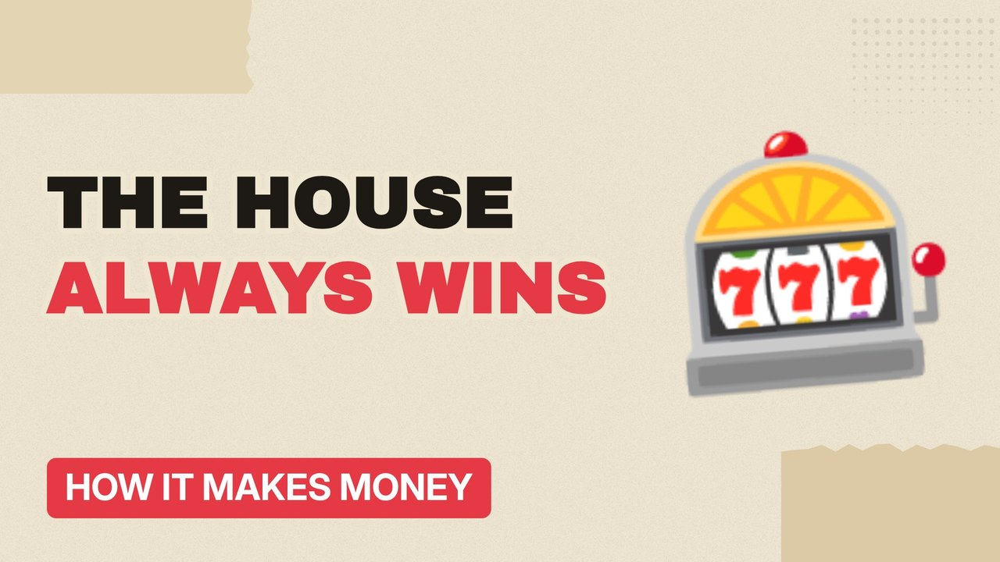

# MV006 · How Casinos Make Money (It's Not Just the Odds)



## Paste this to Claude

```
Make video MV006 from my idea bank: write and fact-check the full 5+ minute script, render it in its style, and send it to me.
```

**Category:** How it makes money  
**Editing style:** Paper collage. Cream paper, torn cut-outs, red marker colours and heavy type. Each new scene slaps down like a card on a table.  
**Length:** 6 to 8 minutes (about 1,000 to 1,300 words)

## Hook (first line)

> A casino doesn't need to cheat you. It just needs you to keep playing.

## Outline

1. The house edge in plain English
2. Why there are no clocks or windows
3. Chips instead of cash
4. Free drinks and comps
5. Slot machine psychology
6. Why the house always wins over time

## YouTube title

How Casinos Make Money (It's Not Just the Odds)

## YouTube description

```
A casino doesn't need to cheat you. It just needs you to keep playing.

In this video:
- The house edge in plain English
- Why there are no clocks or windows
- Chips instead of cash
- Free drinks and comps
- Slot machine psychology
- Why the house always wins over time

Sources are listed here once the script has been fact-checked.
This video is for education and entertainment only and is not financial advice.

#money #businessmodel #howitmakesmoney
```

## Tags

business model, how it makes money, business explained, how casinos make money (it's not just the odds), casinos, make, money, it's, money explained

## Facts to check before scripting

- House edge on roulette (single and double zero)
- Share of casino revenue from slots

## Script approach

Script formula: the hook is the first sentence (no intro), then 4 to 6 chapters, each opening with a question the viewer wants answered. Keep sentences short and spoken. Close every chapter with a mini-cliffhanger into the next, and end on a one-line takeaway.
