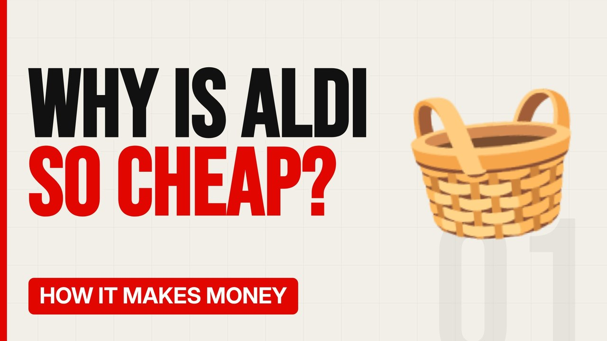

# MV008 · How Aldi Sells Everything So Cheap



## Paste this to Claude

```
Make video MV008 from my idea bank: write and fact-check the full 5+ minute script, render it in its style, and send it to me.
```

**Category:** How it makes money  
**Editing style:** Bold minimal. Off-white page, giant condensed capitals, black and red only. Hard, punchy cuts on the beat.  
**Length:** 6 to 8 minutes (about 1,000 to 1,300 words)

## Hook (first line)

> Aldi sells about a tenth of the products a big supermarket does, and that's its secret weapon.

## Outline

1. Small range, huge buying power
2. Own brands that look familiar
3. Products left in boxes on shelves
4. Fast tills and small teams
5. Cheaper, smaller shops
6. How the big four fought back

## YouTube title

How Aldi Sells Everything So Cheap

## YouTube description

```
Aldi sells about a tenth of the products a big supermarket does, and that's its secret weapon.

In this video:
- Small range, huge buying power
- Own brands that look familiar
- Products left in boxes on shelves
- Fast tills and small teams
- Cheaper, smaller shops
- How the big four fought back

Sources are listed here once the script has been fact-checked.
This video is for education and entertainment only and is not financial advice.

#money #businessmodel #howitmakesmoney
```

## Tags

business model, how it makes money, business explained, how aldi sells everything so cheap, aldi, sells, everything, cheap, money explained

## Facts to check before scripting

- Number of product lines vs a big supermarket
- UK market share and ranking

## Script approach

Script formula: the hook is the first sentence (no intro), then 4 to 6 chapters, each opening with a question the viewer wants answered. Keep sentences short and spoken. Close every chapter with a mini-cliffhanger into the next, and end on a one-line takeaway.
