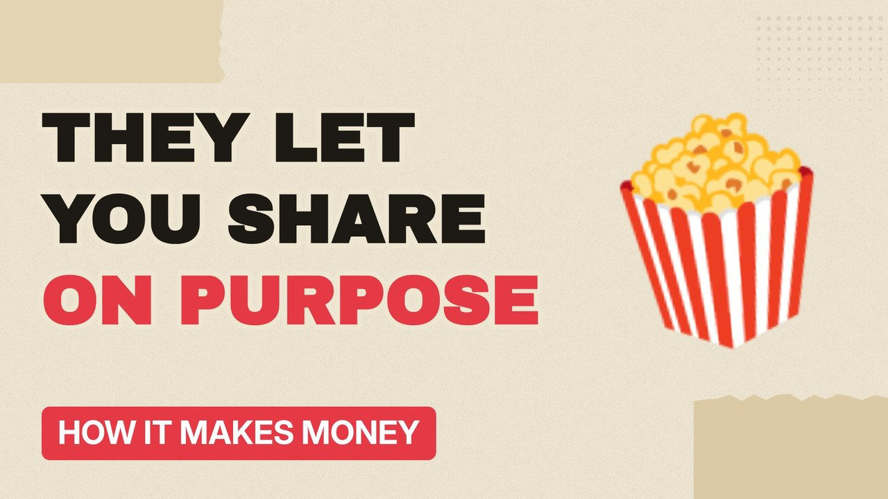

# MV009 · How Netflix Makes Money Now Everyone Shares Passwords



## Paste this to Claude

```
Make video MV009 from my idea bank: write and fact-check the full 5+ minute script, render it in its style, and send it to me.
```

**Category:** How it makes money  
**Editing style:** Paper collage. Cream paper, torn cut-outs, red marker colours and heavy type. Each new scene slaps down like a card on a table.  
**Length:** 6 to 8 minutes (about 1,000 to 1,300 words)

## Hook (first line)

> Netflix let people share passwords for years, then made billions by stopping it.

## Outline

1. The subscription model
2. Why sharing was allowed at first
3. The crackdown and extra member fees
4. Adverts on cheaper plans
5. Spending billions on shows
6. Is streaming getting worse?

## YouTube title

How Netflix Makes Money Now Everyone Shares Passwords

## YouTube description

```
Netflix let people share passwords for years, then made billions by stopping it.

In this video:
- The subscription model
- Why sharing was allowed at first
- The crackdown and extra member fees
- Adverts on cheaper plans
- Spending billions on shows
- Is streaming getting worse?

Sources are listed here once the script has been fact-checked.
This video is for education and entertainment only and is not financial advice.

#money #businessmodel #howitmakesmoney
```

## Tags

business model, how it makes money, business explained, how netflix makes money now everyone shares passwords, netflix, makes, money, everyone, money explained

## Facts to check before scripting

- Subscriber numbers before and after the crackdown
- Year of paid sharing rollout

## Script approach

Script formula: the hook is the first sentence (no intro), then 4 to 6 chapters, each opening with a question the viewer wants answered. Keep sentences short and spoken. Close every chapter with a mini-cliffhanger into the next, and end on a one-line takeaway.
