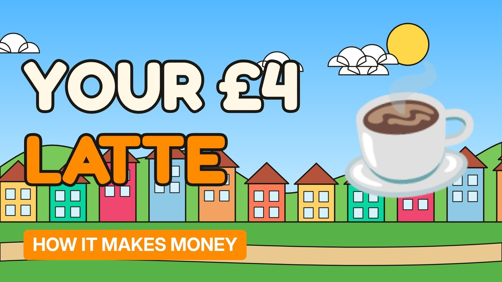

# MV010 · How Coffee Shops Make Money (It's Not the Coffee)



## Paste this to Claude

```
Make video MV010 from my idea bank: write and fact-check the full 5+ minute script, render it in its style, and send it to me.
```

**Category:** How it makes money  
**Editing style:** Cartoon town. Flat 2D cartoon characters in a colourful painted town with ink outlines and speech bubbles. Daylight while the story is set up, then night-blue lighting for the explanation.  
**Length:** 6 to 8 minutes (about 1,000 to 1,300 words)

## Hook (first line)

> The coffee in your £4 latte costs a few pence. So where does the rest of your money go?

## Outline

1. What's actually in the price
2. Rent, staff and the milk
3. Why they sell you a seat, not a drink
4. Loyalty apps and pre-loaded money
5. Chains vs independents
6. Why so many coffee shops close

## YouTube title

How Coffee Shops Make Money (It's Not the Coffee)

## YouTube description

```
The coffee in your £4 latte costs a few pence. So where does the rest of your money go?

In this video:
- What's actually in the price
- Rent, staff and the milk
- Why they sell you a seat, not a drink
- Loyalty apps and pre-loaded money
- Chains vs independents
- Why so many coffee shops close

Sources are listed here once the script has been fact-checked.
This video is for education and entertainment only and is not financial advice.

#money #businessmodel #howitmakesmoney
```

## Tags

business model, how it makes money, business explained, how coffee shops make money (it's not the coffee), coffee, shops, make, money, money explained

## Facts to check before scripting

- Cost breakdown of a latte from a reliable source
- Starbucks customer balances held on cards/apps

## Script approach

Story formula: open on a paradox stated as fact (no intro), set the scene with a named everyday character, escalate in 3 to 5 beats with short dialogue in speech bubbles, then pivot with 'You see,' into the real explanation (lighting turns night-blue) and land on an ironic last line.
