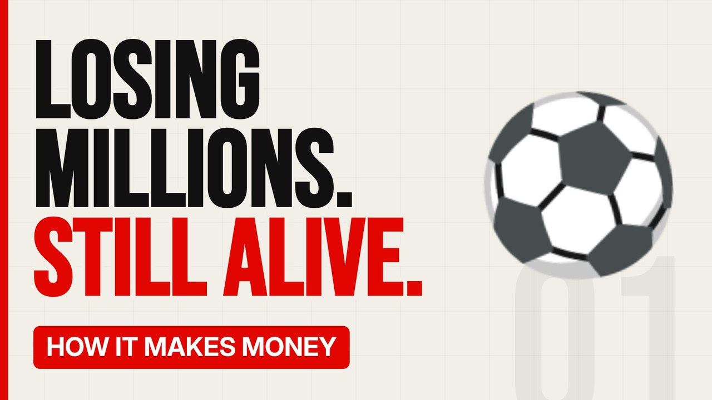

# MV011 · How Football Clubs Lose Money and Still Survive



## Paste this to Claude

```
Make video MV011 from my idea bank: write and fact-check the full 5+ minute script, render it in its style, and send it to me.
```

**Category:** How it makes money  
**Editing style:** Bold minimal. Off-white page, giant condensed capitals, black and red only. Hard, punchy cuts on the beat.  
**Length:** 6 to 8 minutes (about 1,000 to 1,300 words)

## Hook (first line)

> Many football clubs lose money year after year, yet almost none of the big ones ever disappear.

## Outline

1. Where clubs get their money
2. TV rights explained
3. Wages eat everything
4. Owners who cover the losses
5. Spending rules and what breaks them
6. When clubs actually go bust

## YouTube title

How Football Clubs Lose Money and Still Survive

## YouTube description

```
Many football clubs lose money year after year, yet almost none of the big ones ever disappear.

In this video:
- Where clubs get their money
- TV rights explained
- Wages eat everything
- Owners who cover the losses
- Spending rules and what breaks them
- When clubs actually go bust

Sources are listed here once the script has been fact-checked.
This video is for education and entertainment only and is not financial advice.

#money #businessmodel #howitmakesmoney
```

## Tags

business model, how it makes money, business explained, how football clubs lose money and still survive, football, clubs, lose, money, money explained

## Facts to check before scripting

- Premier League TV deal value
- Wage-to-revenue ratios of named clubs (latest accounts)

## Script approach

Script formula: the hook is the first sentence (no intro), then 4 to 6 chapters, each opening with a question the viewer wants answered. Keep sentences short and spoken. Close every chapter with a mini-cliffhanger into the next, and end on a one-line takeaway.
