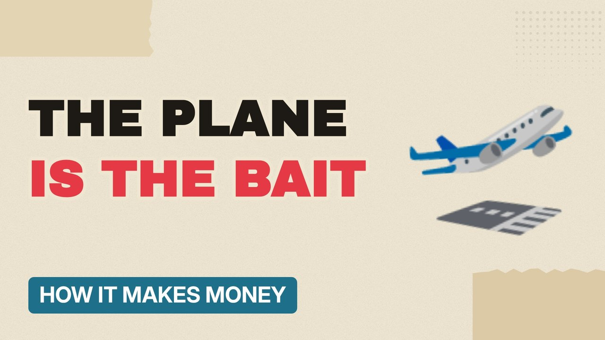

# MV012 · How Airports Make Money (It's Not the Planes)



## Paste this to Claude

```
Make video MV012 from my idea bank: write and fact-check the full 5+ minute script, render it in its style, and send it to me.
```

**Category:** How it makes money  
**Editing style:** Paper collage. Cream paper, torn cut-outs, red marker colours and heavy type. Each new scene slaps down like a card on a table.  
**Length:** 6 to 8 minutes (about 1,000 to 1,300 words)

## Hook (first line)

> Airports earn huge sums from people who aren't flying anywhere at all.

## Outline

1. Airline fees vs shop rents
2. The walk-through duty free
3. Parking and drop-off charges
4. Why food costs more airside
5. Property and advertising
6. Who actually owns airports

## YouTube title

How Airports Make Money (It's Not the Planes)

## YouTube description

```
Airports earn huge sums from people who aren't flying anywhere at all.

In this video:
- Airline fees vs shop rents
- The walk-through duty free
- Parking and drop-off charges
- Why food costs more airside
- Property and advertising
- Who actually owns airports

Sources are listed here once the script has been fact-checked.
This video is for education and entertainment only and is not financial advice.

#money #businessmodel #howitmakesmoney
```

## Tags

business model, how it makes money, business explained, how airports make money (it's not the planes), airports, make, money, it's, money explained

## Facts to check before scripting

- Share of revenue from retail and parking at a UK airport
- Drop-off charge examples

## Script approach

Script formula: the hook is the first sentence (no intro), then 4 to 6 chapters, each opening with a question the viewer wants answered. Keep sentences short and spoken. Close every chapter with a mini-cliffhanger into the next, and end on a one-line takeaway.
