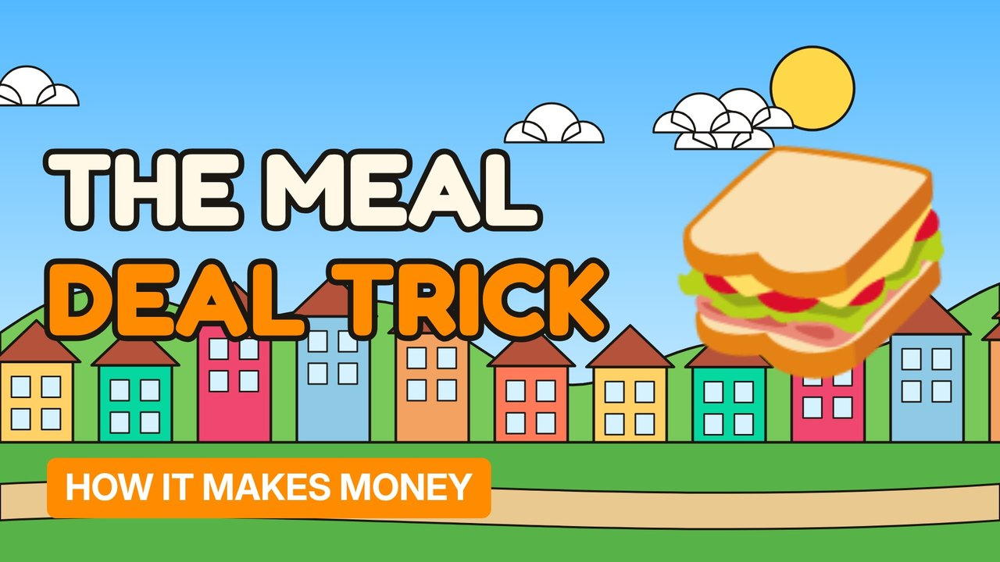

# MV013 · How Supermarket Meal Deals Make Money



## Paste this to Claude

```
Make video MV013 from my idea bank: write and fact-check the full 5+ minute script, render it in its style, and send it to me.
```

**Category:** How it makes money  
**Editing style:** Cartoon town. Flat 2D cartoon characters in a colourful painted town with ink outlines and speech bubbles. Daylight while the story is set up, then night-blue lighting for the explanation.  
**Length:** 6 to 8 minutes (about 1,000 to 1,300 words)

## Hook (first line)

> The meal deal looks like a bargain, and that's exactly what makes it so profitable.

## Outline

1. The bundle trick
2. Why the drink is the profit
3. Getting you into the shop
4. Loyalty card prices
5. What a meal deal really costs to make
6. How to beat it

## YouTube title

How Supermarket Meal Deals Make Money

## YouTube description

```
The meal deal looks like a bargain, and that's exactly what makes it so profitable.

In this video:
- The bundle trick
- Why the drink is the profit
- Getting you into the shop
- Loyalty card prices
- What a meal deal really costs to make
- How to beat it

Sources are listed here once the script has been fact-checked.
This video is for education and entertainment only and is not financial advice.

#money #businessmodel #howitmakesmoney
```

## Tags

business model, how it makes money, business explained, how supermarket meal deals make money, supermarket, meal, deals, make, money explained

## Facts to check before scripting

- Current meal deal prices at major UK supermarkets

## Script approach

Story formula: open on a paradox stated as fact (no intro), set the scene with a named everyday character, escalate in 3 to 5 beats with short dialogue in speech bubbles, then pivot with 'You see,' into the real explanation (lighting turns night-blue) and land on an ironic last line.
