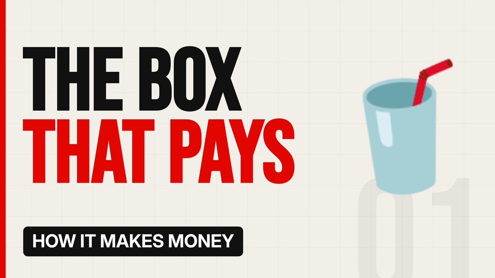

# MV014 · How Vending Machines Quietly Make Money



## Paste this to Claude

```
Make video MV014 from my idea bank: write and fact-check the full 5+ minute script, render it in its style, and send it to me.
```

**Category:** How it makes money  
**Editing style:** Bold minimal. Off-white page, giant condensed capitals, black and red only. Hard, punchy cuts on the beat.  
**Length:** 6 to 8 minutes (about 1,000 to 1,300 words)

## Hook (first line)

> A metal box in a hallway can make money while its owner sleeps. But it's not as easy as it sounds.

## Outline

1. How a vending business works
2. Buying a machine and stock
3. Finding locations
4. Card readers changed everything
5. The real margins
6. Why most people fail

## YouTube title

How Vending Machines Quietly Make Money

## YouTube description

```
A metal box in a hallway can make money while its owner sleeps. But it's not as easy as it sounds.

In this video:
- How a vending business works
- Buying a machine and stock
- Finding locations
- Card readers changed everything
- The real margins
- Why most people fail

Sources are listed here once the script has been fact-checked.
This video is for education and entertainment only and is not financial advice.

#money #businessmodel #howitmakesmoney
```

## Tags

business model, how it makes money, business explained, how vending machines quietly make money, vending, machines, quietly, make, money explained

## Facts to check before scripting

- Typical machine price and margins from industry sources

## Script approach

Script formula: the hook is the first sentence (no intro), then 4 to 6 chapters, each opening with a question the viewer wants answered. Keep sentences short and spoken. Close every chapter with a mini-cliffhanger into the next, and end on a one-line takeaway.
