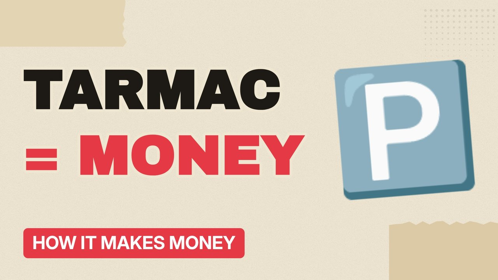

# MV015 · How Car Parks Make Money (The Most Boring Business)



## Paste this to Claude

```
Make video MV015 from my idea bank: write and fact-check the full 5+ minute script, render it in its style, and send it to me.
```

**Category:** How it makes money  
**Editing style:** Paper collage. Cream paper, torn cut-outs, red marker colours and heavy type. Each new scene slaps down like a card on a table.  
**Length:** 6 to 8 minutes (about 1,000 to 1,300 words)

## Hook (first line)

> Some of the most reliable money in Britain comes from rectangles of tarmac.

## Outline

1. Why parking is a great business
2. Private parking charges explained
3. Automatic number plate cameras
4. The rules on fines and appeals
5. Who owns the car parks
6. How to avoid getting caught out

## YouTube title

How Car Parks Make Money (The Most Boring Business)

## YouTube description

```
Some of the most reliable money in Britain comes from rectangles of tarmac.

In this video:
- Why parking is a great business
- Private parking charges explained
- Automatic number plate cameras
- The rules on fines and appeals
- Who owns the car parks
- How to avoid getting caught out

Sources are listed here once the script has been fact-checked.
This video is for education and entertainment only and is not financial advice.

#money #businessmodel #howitmakesmoney
```

## Tags

business model, how it makes money, business explained, how car parks make money (the most boring business), parks, make, money, most, money explained

## Facts to check before scripting

- Rules on private parking charges and appeals in England
- Number of tickets issued (DVLA data)

## Script approach

Script formula: the hook is the first sentence (no intro), then 4 to 6 chapters, each opening with a question the viewer wants answered. Keep sentences short and spoken. Close every chapter with a mini-cliffhanger into the next, and end on a one-line takeaway.
