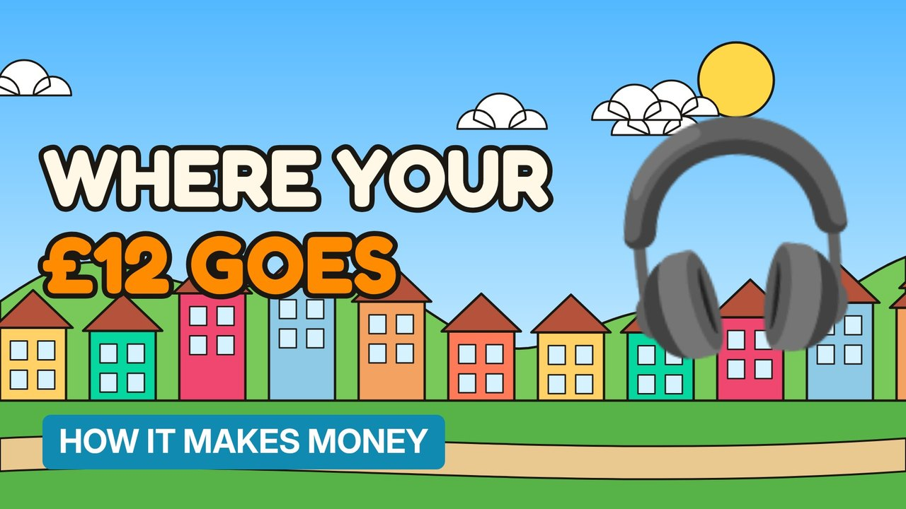

# MV016 · How Spotify Makes (and Loses) Money



## Paste this to Claude

```
Make video MV016 from my idea bank: write and fact-check the full 5+ minute script, render it in its style, and send it to me.
```

**Category:** How it makes money  
**Editing style:** Cartoon town. Flat 2D cartoon characters in a colourful painted town with ink outlines and speech bubbles. Daylight while the story is set up, then night-blue lighting for the explanation.  
**Length:** 6 to 8 minutes (about 1,000 to 1,300 words)

## Hook (first line)

> Spotify is used by hundreds of millions of people, and for years it barely made a profit.

## Outline

1. Where your subscription goes
2. Paying the record labels
3. Why artists say they get so little
4. Podcasts and audiobooks
5. Price rises
6. Is it finally profitable?

## YouTube title

How Spotify Makes (and Loses) Money

## YouTube description

```
Spotify is used by hundreds of millions of people, and for years it barely made a profit.

In this video:
- Where your subscription goes
- Paying the record labels
- Why artists say they get so little
- Podcasts and audiobooks
- Price rises
- Is it finally profitable?

Sources are listed here once the script has been fact-checked.
This video is for education and entertainment only and is not financial advice.

#money #businessmodel #howitmakesmoney
```

## Tags

business model, how it makes money, business explained, how spotify makes (and loses) money, spotify, makes, loses, money, money explained

## Facts to check before scripting

- Monthly active users and subscribers
- Share of revenue paid to rights holders
- Recent profit/loss

## Script approach

Story formula: open on a paradox stated as fact (no intro), set the scene with a named everyday character, escalate in 3 to 5 beats with short dialogue in speech bubbles, then pivot with 'You see,' into the real explanation (lighting turns night-blue) and land on an ironic last line.
