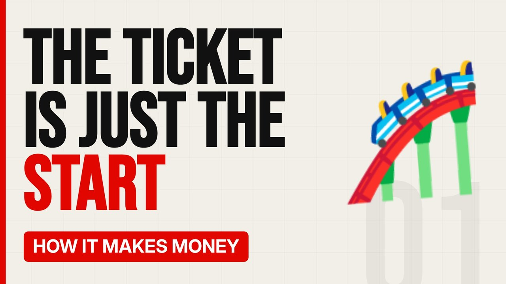

# MV017 · How Theme Parks Make Money (It's Not the Tickets)



## Paste this to Claude

```
Make video MV017 from my idea bank: write and fact-check the full 5+ minute script, render it in its style, and send it to me.
```

**Category:** How it makes money  
**Editing style:** Bold minimal. Off-white page, giant condensed capitals, black and red only. Hard, punchy cuts on the beat.  
**Length:** 6 to 8 minutes (about 1,000 to 1,300 words)

## Hook (first line)

> A theme park ticket gets you through the gate. Everything after that is where the money's made.

## Outline

1. Gate price vs spend inside
2. Fast passes and queue skipping
3. Food and photo sales
4. Hotels and season passes
5. Why parks keep building new rides
6. The British theme park story

## YouTube title

How Theme Parks Make Money (It's Not the Tickets)

## YouTube description

```
A theme park ticket gets you through the gate. Everything after that is where the money's made.

In this video:
- Gate price vs spend inside
- Fast passes and queue skipping
- Food and photo sales
- Hotels and season passes
- Why parks keep building new rides
- The British theme park story

Sources are listed here once the script has been fact-checked.
This video is for education and entertainment only and is not financial advice.

#money #businessmodel #howitmakesmoney
```

## Tags

business model, how it makes money, business explained, how theme parks make money (it's not the tickets), theme, parks, make, money, money explained

## Facts to check before scripting

- Average spend per visitor from an operator report

## Script approach

Script formula: the hook is the first sentence (no intro), then 4 to 6 chapters, each opening with a question the viewer wants answered. Keep sentences short and spoken. Close every chapter with a mini-cliffhanger into the next, and end on a one-line takeaway.
