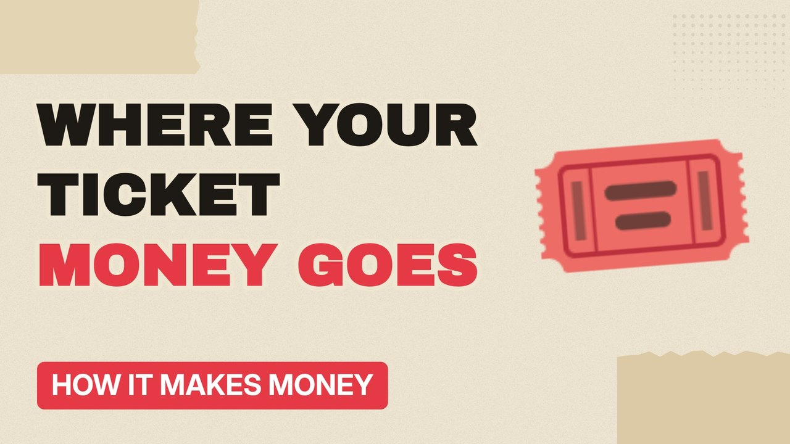

# MV018 · How the National Lottery Actually Makes Money



## Paste this to Claude

```
Make video MV018 from my idea bank: write and fact-check the full 5+ minute script, render it in its style, and send it to me.
```

**Category:** How it makes money  
**Editing style:** Paper collage. Cream paper, torn cut-outs, red marker colours and heavy type. Each new scene slaps down like a card on a table.  
**Length:** 6 to 8 minutes (about 1,000 to 1,300 words)

## Hook (first line)

> Every week millions of tickets are bought, and only about half of that money goes back as prizes.

## Outline

1. Where each £2 goes
2. Prizes, good causes, tax and the operator
3. Why the odds are what they are
4. Scratchcards vs draws
5. Who plays most
6. Is it really a tax on hope?

## YouTube title

How the National Lottery Actually Makes Money

## YouTube description

```
Every week millions of tickets are bought, and only about half of that money goes back as prizes.

In this video:
- Where each £2 goes
- Prizes, good causes, tax and the operator
- Why the odds are what they are
- Scratchcards vs draws
- Who plays most
- Is it really a tax on hope?

Sources are listed here once the script has been fact-checked.
This video is for education and entertainment only and is not financial advice.

#money #businessmodel #howitmakesmoney
```

## Tags

business model, how it makes money, business explained, how the national lottery actually makes money, national, lottery, actually, makes, money explained

## Facts to check before scripting

- Breakdown of each pound (prizes, good causes, duty, operator)
- Odds of the jackpot

## Script approach

Script formula: the hook is the first sentence (no intro), then 4 to 6 chapters, each opening with a question the viewer wants answered. Keep sentences short and spoken. Close every chapter with a mini-cliffhanger into the next, and end on a one-line takeaway.
