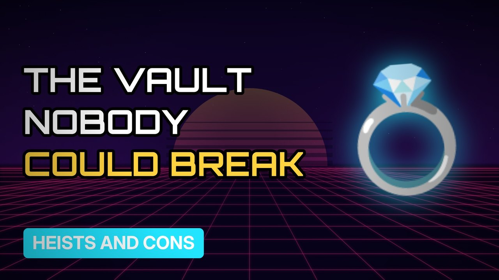

# MV020 · The Antwerp Diamond Heist: The Vault That Couldn't Be Broken



## Paste this to Claude

```
Make video MV020 from my idea bank: write and fact-check the full 5+ minute script, render it in its style, and send it to me.
```

**Category:** Heists and cons  
**Editing style:** Synthwave neon. Purple night sky, glowing grid floor and neon type. Scenes change with a quick glitch.  
**Length:** 6 to 8 minutes (about 1,000 to 1,300 words)

## Hook (first line)

> Ten layers of security, a vault deep underground, and a gang still got in.

## Outline

1. The diamond capital of the world
2. Ten layers of security
3. Planning for years
4. The night of the heist
5. The half-eaten sandwich
6. The diamonds never found

## YouTube title

The Antwerp Diamond Heist: The Vault That Couldn't Be Broken

## YouTube description

```
Ten layers of security, a vault deep underground, and a gang still got in.

In this video:
- The diamond capital of the world
- Ten layers of security
- Planning for years
- The night of the heist
- The half-eaten sandwich
- The diamonds never found

Sources are listed here once the script has been fact-checked.
This video is for education and entertainment only and is not financial advice.

#money #truecrime #heist
```

## Tags

true crime, heist, scam, con artist, the antwerp diamond heist, antwerp, diamond, vault, money explained

## Facts to check before scripting

- Year (2003)
- Estimated value
- How the gang was traced

## Script approach

Script formula: the hook is the first sentence (no intro), then 4 to 6 chapters, each opening with a question the viewer wants answered. Keep sentences short and spoken. Close every chapter with a mini-cliffhanger into the next, and end on a one-line takeaway.
