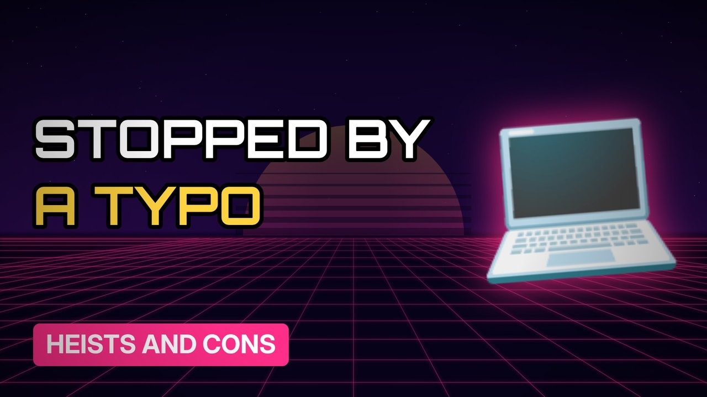

# MV022 · The Bangladesh Bank Hack: $1 Billion and One Typo



## Paste this to Claude

```
Make video MV022 from my idea bank: write and fact-check the full 5+ minute script, render it in its style, and send it to me.
```

**Category:** Heists and cons  
**Editing style:** Synthwave neon. Purple night sky, glowing grid floor and neon type. Scenes change with a quick glitch.  
**Length:** 6 to 8 minutes (about 1,000 to 1,300 words)

## Hook (first line)

> Hackers tried to steal nearly a billion dollars from a central bank, and a spelling mistake helped stop them.

## Outline

1. How central banks move money
2. Getting inside the system
3. The weekend timing
4. The typo that raised the alarm
5. Where the money went
6. Who was blamed

## YouTube title

The Bangladesh Bank Hack: $1 Billion and One Typo

## YouTube description

```
Hackers tried to steal nearly a billion dollars from a central bank, and a spelling mistake helped stop them.

In this video:
- How central banks move money
- Getting inside the system
- The weekend timing
- The typo that raised the alarm
- Where the money went
- Who was blamed

Sources are listed here once the script has been fact-checked.
This video is for education and entertainment only and is not financial advice.

#money #truecrime #heist
```

## Tags

true crime, heist, scam, con artist, the bangladesh bank hack, bangladesh, bank, hack, billion, money explained

## Facts to check before scripting

- Amount attempted vs amount stolen
- The misspelling
- Year (2016)
- Who US authorities blamed

## Script approach

Script formula: the hook is the first sentence (no intro), then 4 to 6 chapters, each opening with a question the viewer wants answered. Keep sentences short and spoken. Close every chapter with a mini-cliffhanger into the next, and end on a one-line takeaway.
