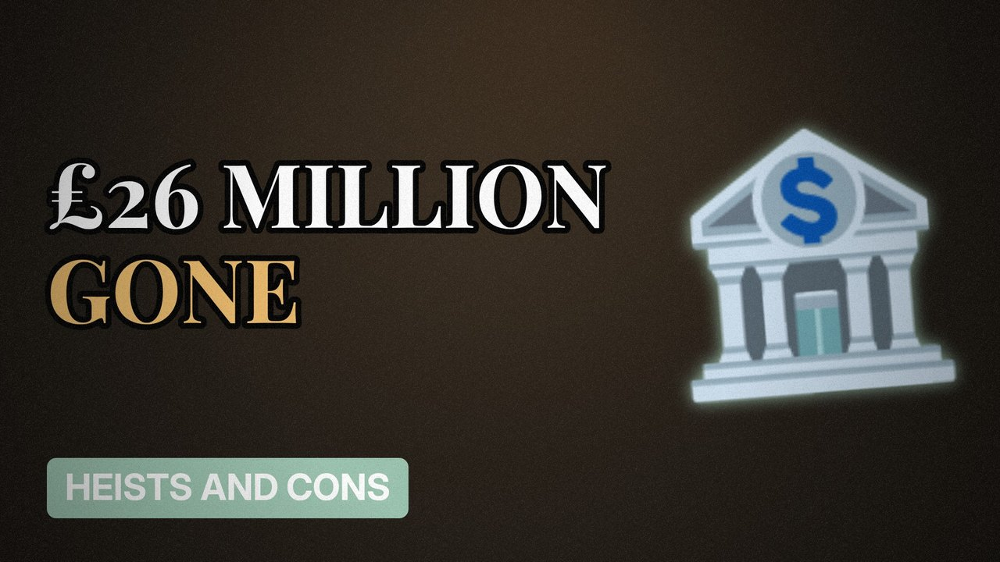

# MV023 · The Northern Bank Robbery: £26 Million From Belfast



## Paste this to Claude

```
Make video MV023 from my idea bank: write and fact-check the full 5+ minute script, render it in its style, and send it to me.
```

**Category:** Heists and cons  
**Editing style:** Archive documentary. Film grain, letterbox bars, serif type, newspaper cuttings and maps. The camera pans sideways from one moment to the next instead of cutting.  
**Length:** 6 to 8 minutes (about 1,000 to 1,300 words)

## Hook (first line)

> In 2004, robbers took more cash from one Belfast bank than any heist in UK history before it.

## Outline

1. Two families held hostage
2. The bank vault in the city centre
3. Who was blamed
4. Why Northern Bank reissued its notes
5. Where the money went
6. Unanswered questions

## YouTube title

The Northern Bank Robbery: £26 Million From Belfast

## YouTube description

```
In 2004, robbers took more cash from one Belfast bank than any heist in UK history before it.

In this video:
- Two families held hostage
- The bank vault in the city centre
- Who was blamed
- Why Northern Bank reissued its notes
- Where the money went
- Unanswered questions

Sources are listed here once the script has been fact-checked.
This video is for education and entertainment only and is not financial advice.

#money #truecrime #heist
```

## Tags

true crime, heist, scam, con artist, the northern bank robbery, northern, bank, robbery, million, money explained

## Facts to check before scripting

- Amount (£26.5m)
- Banknote recall details
- Official attribution and denials

## Script approach

Script formula: the hook is the first sentence (no intro), then 4 to 6 chapters, each opening with a question the viewer wants answered. Keep sentences short and spoken. Close every chapter with a mini-cliffhanger into the next, and end on a one-line takeaway.
