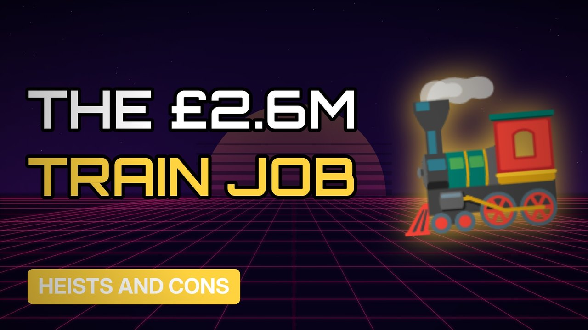

# MV024 · The Great Train Robbery: What Really Happened



## Paste this to Claude

```
Make video MV024 from my idea bank: write and fact-check the full 5+ minute script, render it in its style, and send it to me.
```

**Category:** Heists and cons  
**Editing style:** Synthwave neon. Purple night sky, glowing grid floor and neon type. Scenes change with a quick glitch.  
**Length:** 6 to 8 minutes (about 1,000 to 1,300 words)

## Hook (first line)

> In 1963 a gang stopped a mail train with a fake signal and took £2.6 million in old notes.

## Outline

1. The overnight mail train
2. The fake red light
3. The farmhouse hideout
4. The fingerprints on the Monopoly board
5. Ronnie Biggs and the escape
6. Money worth today

## YouTube title

The Great Train Robbery: What Really Happened

## YouTube description

```
In 1963 a gang stopped a mail train with a fake signal and took £2.6 million in old notes.

In this video:
- The overnight mail train
- The fake red light
- The farmhouse hideout
- The fingerprints on the Monopoly board
- Ronnie Biggs and the escape
- Money worth today

Sources are listed here once the script has been fact-checked.
This video is for education and entertainment only and is not financial advice.

#money #truecrime #heist
```

## Tags

true crime, heist, scam, con artist, the great train robbery, great, train, robbery, what, money explained

## Facts to check before scripting

- Amount (£2.6m)
- Year (1963)
- Today's equivalent value

## Script approach

Script formula: the hook is the first sentence (no intro), then 4 to 6 chapters, each opening with a question the viewer wants answered. Keep sentences short and spoken. Close every chapter with a mini-cliffhanger into the next, and end on a one-line takeaway.
