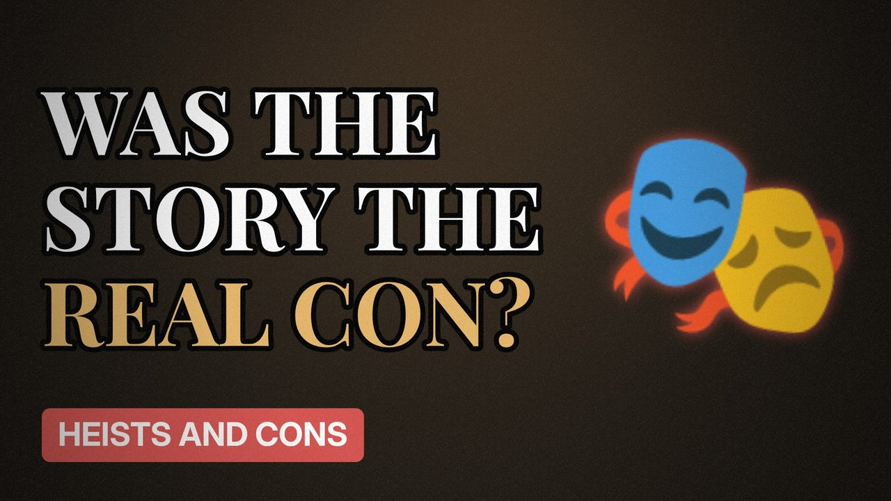

# MV025 · Frank Abagnale: The Con Man Whose Story Might Be a Con



## Paste this to Claude

```
Make video MV025 from my idea bank: write and fact-check the full 5+ minute script, render it in its style, and send it to me.
```

**Category:** Heists and cons  
**Editing style:** Archive documentary. Film grain, letterbox bars, serif type, newspaper cuttings and maps. The camera pans sideways from one moment to the next instead of cutting.  
**Length:** 6 to 8 minutes (about 1,000 to 1,300 words)

## Hook (first line)

> The world's most famous con man may have pulled his biggest trick on all of us.

## Outline

1. The 'Catch Me If You Can' legend
2. What he claimed
3. What records show
4. Researchers who checked his story
5. Why the myth survived
6. What's actually true

## YouTube title

Frank Abagnale: The Con Man Whose Story Might Be a Con

## YouTube description

```
The world's most famous con man may have pulled his biggest trick on all of us.

In this video:
- The 'Catch Me If You Can' legend
- What he claimed
- What records show
- Researchers who checked his story
- Why the myth survived
- What's actually true

Sources are listed here once the script has been fact-checked.
This video is for education and entertainment only and is not financial advice.

#money #truecrime #heist
```

## Tags

true crime, heist, scam, con artist, frank abagnale, frank, abagnale, whose, story, money explained

## Facts to check before scripting

- Which claims are disputed and by whom (books, journalism)

## Script approach

Script formula: the hook is the first sentence (no intro), then 4 to 6 chapters, each opening with a question the viewer wants answered. Keep sentences short and spoken. Close every chapter with a mini-cliffhanger into the next, and end on a one-line takeaway.
