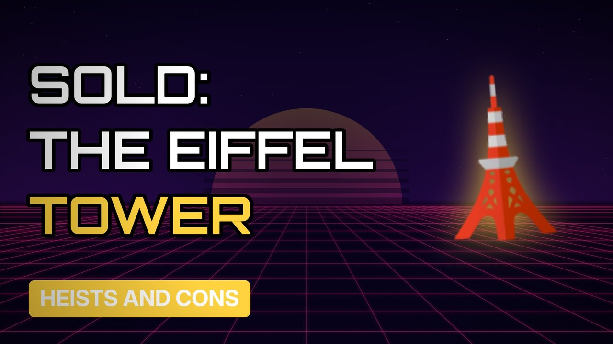

# MV026 · The Man Who Sold the Eiffel Tower. Twice.



## Paste this to Claude

```
Make video MV026 from my idea bank: write and fact-check the full 5+ minute script, render it in its style, and send it to me.
```

**Category:** Heists and cons  
**Editing style:** Synthwave neon. Purple night sky, glowing grid floor and neon type. Scenes change with a quick glitch.  
**Length:** 6 to 8 minutes (about 1,000 to 1,300 words)

## Hook (first line)

> In 1925 a con man convinced businessmen that Paris was selling the Eiffel Tower for scrap.

## Outline

1. Paris after the war
2. Victor Lustig's fake government role
3. The secret auction
4. Why the victim stayed quiet
5. Trying it again
6. The money printing box

## YouTube title

The Man Who Sold the Eiffel Tower. Twice.

## YouTube description

```
In 1925 a con man convinced businessmen that Paris was selling the Eiffel Tower for scrap.

In this video:
- Paris after the war
- Victor Lustig's fake government role
- The secret auction
- Why the victim stayed quiet
- Trying it again
- The money printing box

Sources are listed here once the script has been fact-checked.
This video is for education and entertainment only and is not financial advice.

#money #truecrime #heist
```

## Tags

true crime, heist, scam, con artist, the man who sold the eiffel tower. twice., sold, eiffel, tower, twice, money explained

## Facts to check before scripting

- Year and details of the scheme
- Lustig's later arrest for counterfeiting

## Script approach

Script formula: the hook is the first sentence (no intro), then 4 to 6 chapters, each opening with a question the viewer wants answered. Keep sentences short and spoken. Close every chapter with a mini-cliffhanger into the next, and end on a one-line takeaway.
