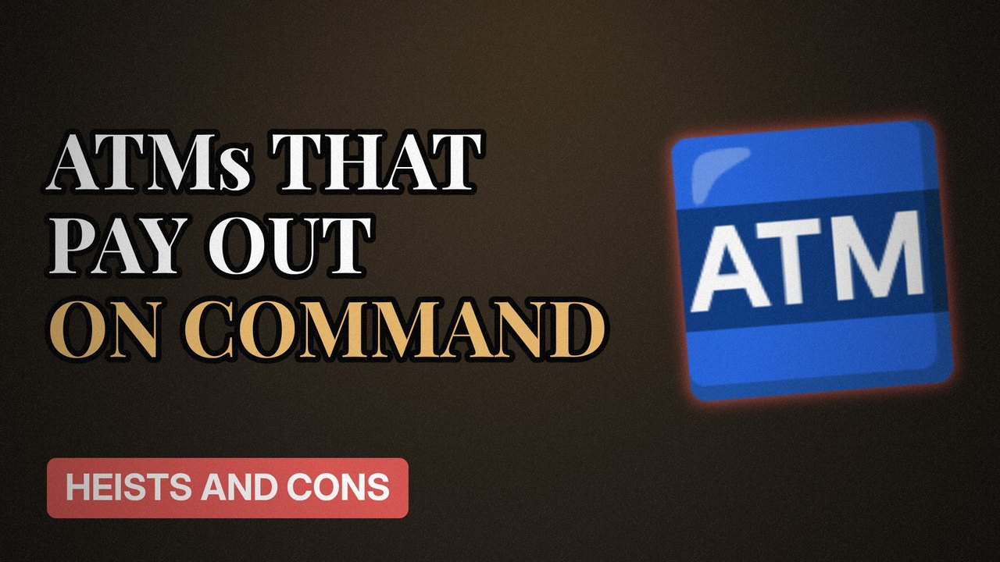

# MV029 · The Hackers Who Made ATMs Spit Out Cash



## Paste this to Claude

```
Make video MV029 from my idea bank: write and fact-check the full 5+ minute script, render it in its style, and send it to me.
```

**Category:** Heists and cons  
**Editing style:** Archive documentary. Film grain, letterbox bars, serif type, newspaper cuttings and maps. The camera pans sideways from one moment to the next instead of cutting.  
**Length:** 6 to 8 minutes (about 1,000 to 1,300 words)

## Hook (first line)

> A gang of hackers made cash machines pour out money on command, without touching a card.

## Outline

1. How bank networks work
2. The malware hidden in emails
3. Watching bank staff for months
4. Cash machines on a timer
5. Banks around the world hit
6. The arrest

## YouTube title

The Hackers Who Made ATMs Spit Out Cash

## YouTube description

```
A gang of hackers made cash machines pour out money on command, without touching a card.

In this video:
- How bank networks work
- The malware hidden in emails
- Watching bank staff for months
- Cash machines on a timer
- Banks around the world hit
- The arrest

Sources are listed here once the script has been fact-checked.
This video is for education and entertainment only and is not financial advice.

#money #truecrime #heist
```

## Tags

true crime, heist, scam, con artist, the hackers who made atms spit out cash, hackers, made, atms, spit, money explained

## Facts to check before scripting

- Gang name (Carbanak) and estimated total
- Arrest year and location

## Script approach

Script formula: the hook is the first sentence (no intro), then 4 to 6 chapters, each opening with a question the viewer wants answered. Keep sentences short and spoken. Close every chapter with a mini-cliffhanger into the next, and end on a one-line takeaway.
