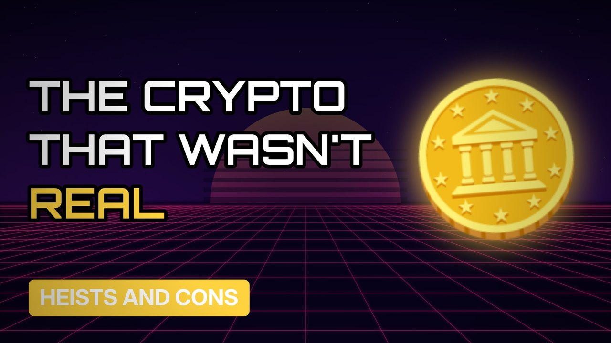

# MV030 · OneCoin: The Crypto That Never Existed



## Paste this to Claude

```
Make video MV030 from my idea bank: write and fact-check the full 5+ minute script, render it in its style, and send it to me.
```

**Category:** Heists and cons  
**Editing style:** Synthwave neon. Purple night sky, glowing grid floor and neon type. Scenes change with a quick glitch.  
**Length:** 6 to 8 minutes (about 1,000 to 1,300 words)

## Hook (first line)

> Millions of people bought a cryptocurrency that had no real blockchain behind it.

## Outline

1. The launch and the glamour
2. Selling to friends and family
3. Why there was no real coin
4. The founder vanishes
5. Billions missing
6. How to spot the next one

## YouTube title

OneCoin: The Crypto That Never Existed

## YouTube description

```
Millions of people bought a cryptocurrency that had no real blockchain behind it.

In this video:
- The launch and the glamour
- Selling to friends and family
- Why there was no real coin
- The founder vanishes
- Billions missing
- How to spot the next one

Sources are listed here once the script has been fact-checked.
This video is for education and entertainment only and is not financial advice.

#money #truecrime #heist
```

## Tags

true crime, heist, scam, con artist, onecoin, crypto, that, never, money explained

## Facts to check before scripting

- Estimated amount raised
- Year the founder disappeared (2017)
- FBI most wanted listing

## Script approach

Script formula: the hook is the first sentence (no intro), then 4 to 6 chapters, each opening with a question the viewer wants answered. Keep sentences short and spoken. Close every chapter with a mini-cliffhanger into the next, and end on a one-line takeaway.
