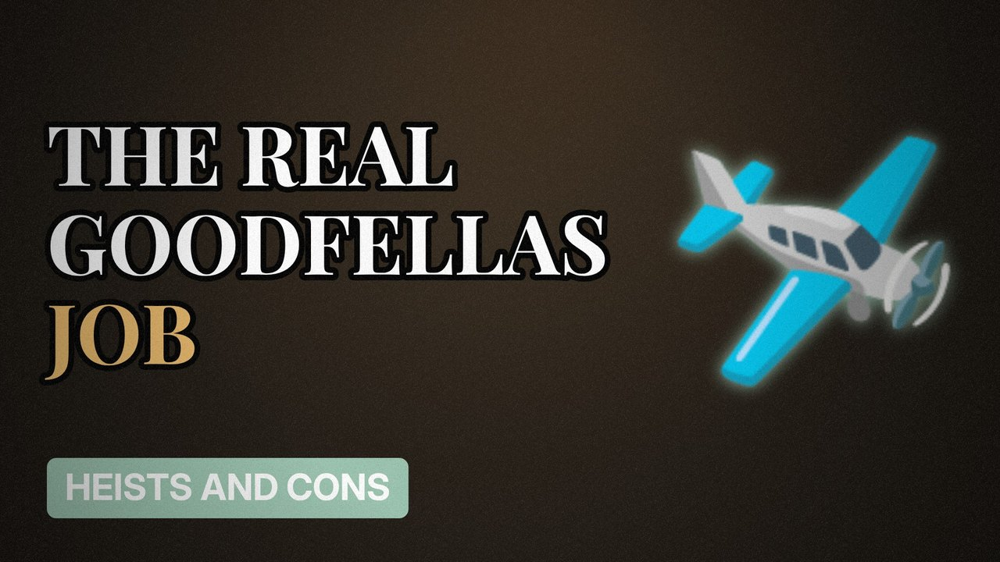

# MV031 · The Lufthansa Heist: The Job Behind Goodfellas



## Paste this to Claude

```
Make video MV031 from my idea bank: write and fact-check the full 5+ minute script, render it in its style, and send it to me.
```

**Category:** Heists and cons  
**Editing style:** Archive documentary. Film grain, letterbox bars, serif type, newspaper cuttings and maps. The camera pans sideways from one moment to the next instead of cutting.  
**Length:** 6 to 8 minutes (about 1,000 to 1,300 words)

## Hook (first line)

> The biggest cash robbery in America at the time ended with almost everyone involved dead or in prison.

## Outline

1. JFK airport, 1978
2. The inside tip
3. The cash and jewels
4. The wrong van left behind
5. What happened next
6. Goodfellas vs reality

## YouTube title

The Lufthansa Heist: The Job Behind Goodfellas

## YouTube description

```
The biggest cash robbery in America at the time ended with almost everyone involved dead or in prison.

In this video:
- JFK airport, 1978
- The inside tip
- The cash and jewels
- The wrong van left behind
- What happened next
- Goodfellas vs reality

Sources are listed here once the script has been fact-checked.
This video is for education and entertainment only and is not financial advice.

#money #truecrime #heist
```

## Tags

true crime, heist, scam, con artist, the lufthansa heist, lufthansa, behind, goodfellas, money explained

## Facts to check before scripting

- Amount stolen
- Year (1978)
- Convictions

## Script approach

Script formula: the hook is the first sentence (no intro), then 4 to 6 chapters, each opening with a question the viewer wants answered. Keep sentences short and spoken. Close every chapter with a mini-cliffhanger into the next, and end on a one-line takeaway.
