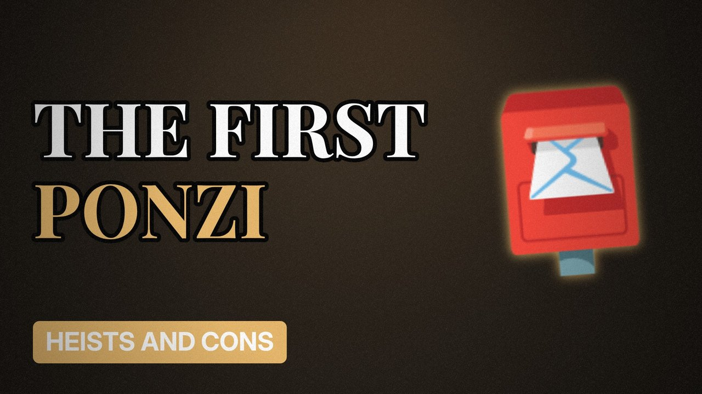

# MV033 · Charles Ponzi: The Man Behind the Name



## Paste this to Claude

```
Make video MV033 from my idea bank: write and fact-check the full 5+ minute script, render it in its style, and send it to me.
```

**Category:** Heists and cons  
**Editing style:** Archive documentary. Film grain, letterbox bars, serif type, newspaper cuttings and maps. The camera pans sideways from one moment to the next instead of cutting.  
**Length:** 6 to 8 minutes (about 1,000 to 1,300 words)

## Hook (first line)

> Before every Ponzi scheme, there was Charles Ponzi, and his plan started with postage stamps.

## Outline

1. International reply coupons
2. The 50% in 45 days promise
3. Paying old investors with new money
4. The newspaper that exposed him
5. Collapse and prison
6. Why it still works today

## YouTube title

Charles Ponzi: The Man Behind the Name

## YouTube description

```
Before every Ponzi scheme, there was Charles Ponzi, and his plan started with postage stamps.

In this video:
- International reply coupons
- The 50% in 45 days promise
- Paying old investors with new money
- The newspaper that exposed him
- Collapse and prison
- Why it still works today

Sources are listed here once the script has been fact-checked.
This video is for education and entertainment only and is not financial advice.

#money #truecrime #heist
```

## Tags

true crime, heist, scam, con artist, charles ponzi, charles, ponzi, behind, name, money explained

## Facts to check before scripting

- Year (1920)
- Promised returns
- Estimated losses

## Script approach

Script formula: the hook is the first sentence (no intro), then 4 to 6 chapters, each opening with a question the viewer wants answered. Keep sentences short and spoken. Close every chapter with a mini-cliffhanger into the next, and end on a one-line takeaway.
