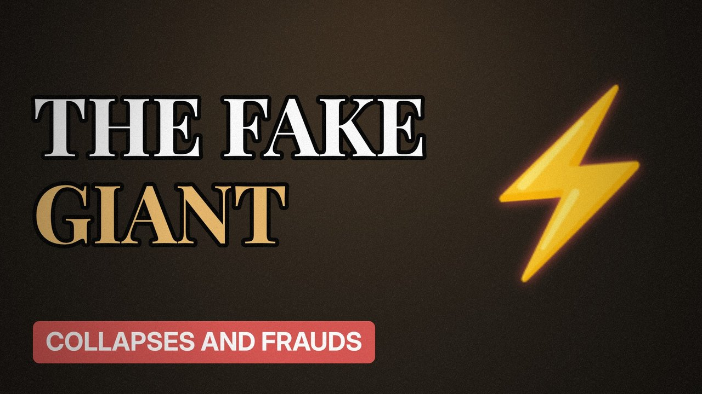

# MV035 · Enron: The Smartest Guys in the Room Weren't



## Paste this to Claude

```
Make video MV035 from my idea bank: write and fact-check the full 5+ minute script, render it in its style, and send it to me.
```

**Category:** Collapses and frauds  
**Editing style:** Archive documentary. Film grain, letterbox bars, serif type, newspaper cuttings and maps. The camera pans sideways from one moment to the next instead of cutting.  
**Length:** 6 to 8 minutes (about 1,000 to 1,300 words)

## Hook (first line)

> America's seventh-largest company turned out to be built on profits that didn't exist.

## Outline

1. From pipelines to trading
2. Mark-to-market accounting
3. Hidden debts in side companies
4. Rolling blackouts in California
5. The collapse
6. Why auditors changed forever

## YouTube title

Enron: The Smartest Guys in the Room Weren't

## YouTube description

```
America's seventh-largest company turned out to be built on profits that didn't exist.

In this video:
- From pipelines to trading
- Mark-to-market accounting
- Hidden debts in side companies
- Rolling blackouts in California
- The collapse
- Why auditors changed forever

Sources are listed here once the script has been fact-checked.
This video is for education and entertainment only and is not financial advice.

#money #corporatefraud #companycollapse
```

## Tags

corporate fraud, company collapse, finance documentary, enron, smartest, guys, room, money explained

## Facts to check before scripting

- Year of bankruptcy (2001)
- Ranking and revenue figures
- Arthur Andersen outcome

## Script approach

Script formula: the hook is the first sentence (no intro), then 4 to 6 chapters, each opening with a question the viewer wants answered. Keep sentences short and spoken. Close every chapter with a mini-cliffhanger into the next, and end on a one-line takeaway.
