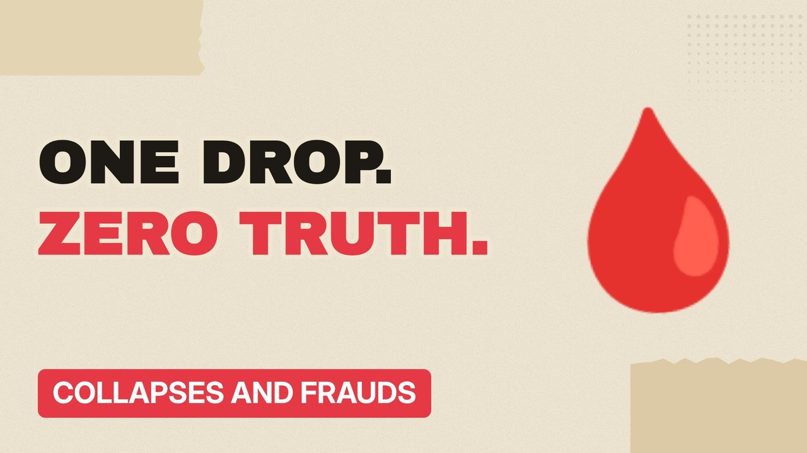

# MV036 · Theranos: The Blood Test That Didn't Work



## Paste this to Claude

```
Make video MV036 from my idea bank: write and fact-check the full 5+ minute script, render it in its style, and send it to me.
```

**Category:** Collapses and frauds  
**Editing style:** Paper collage. Cream paper, torn cut-outs, red marker colours and heavy type. Each new scene slaps down like a card on a table.  
**Length:** 6 to 8 minutes (about 1,000 to 1,300 words)

## Hook (first line)

> A company worth billions promised hundreds of tests from one drop of blood. The machines couldn't do it.

## Outline

1. The big promise
2. Famous board members
3. Testing in real shops
4. The whistleblowers
5. The journalist who broke it
6. Trial and prison

## YouTube title

Theranos: The Blood Test That Didn't Work

## YouTube description

```
A company worth billions promised hundreds of tests from one drop of blood. The machines couldn't do it.

In this video:
- The big promise
- Famous board members
- Testing in real shops
- The whistleblowers
- The journalist who broke it
- Trial and prison

Sources are listed here once the script has been fact-checked.
This video is for education and entertainment only and is not financial advice.

#money #corporatefraud #companycollapse
```

## Tags

corporate fraud, company collapse, finance documentary, theranos, blood, test, that, money explained

## Facts to check before scripting

- Peak valuation
- Sentence
- Year of conviction (2022)

## Script approach

Script formula: the hook is the first sentence (no intro), then 4 to 6 chapters, each opening with a question the viewer wants answered. Keep sentences short and spoken. Close every chapter with a mini-cliffhanger into the next, and end on a one-line takeaway.
