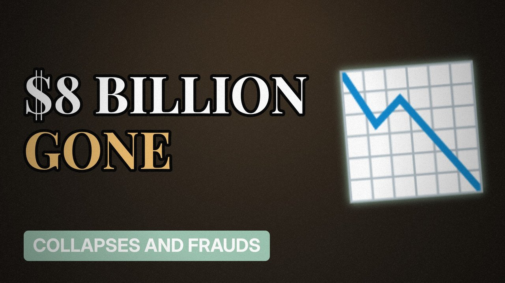

# MV037 · FTX: How Billions Vanished Overnight



## Paste this to Claude

```
Make video MV037 from my idea bank: write and fact-check the full 5+ minute script, render it in its style, and send it to me.
```

**Category:** Collapses and frauds  
**Editing style:** Archive documentary. Film grain, letterbox bars, serif type, newspaper cuttings and maps. The camera pans sideways from one moment to the next instead of cutting.  
**Length:** 6 to 8 minutes (about 1,000 to 1,300 words)

## Hook (first line)

> One of the world's biggest crypto exchanges collapsed in about a week, and customer money was missing.

## Outline

1. The rise of FTX
2. The sister trading firm
3. Customer money moved
4. The leaked balance sheet
5. The bank run
6. Trial and sentence

## YouTube title

FTX: How Billions Vanished Overnight

## YouTube description

```
One of the world's biggest crypto exchanges collapsed in about a week, and customer money was missing.

In this video:
- The rise of FTX
- The sister trading firm
- Customer money moved
- The leaked balance sheet
- The bank run
- Trial and sentence

Sources are listed here once the script has been fact-checked.
This video is for education and entertainment only and is not financial advice.

#money #corporatefraud #companycollapse
```

## Tags

corporate fraud, company collapse, finance documentary, ftx, billions, vanished, overnight, money explained

## Facts to check before scripting

- Amount of customer funds missing
- Conviction and sentence
- Customer repayment status (check latest)

## Script approach

Script formula: the hook is the first sentence (no intro), then 4 to 6 chapters, each opening with a question the viewer wants answered. Keep sentences short and spoken. Close every chapter with a mini-cliffhanger into the next, and end on a one-line takeaway.
