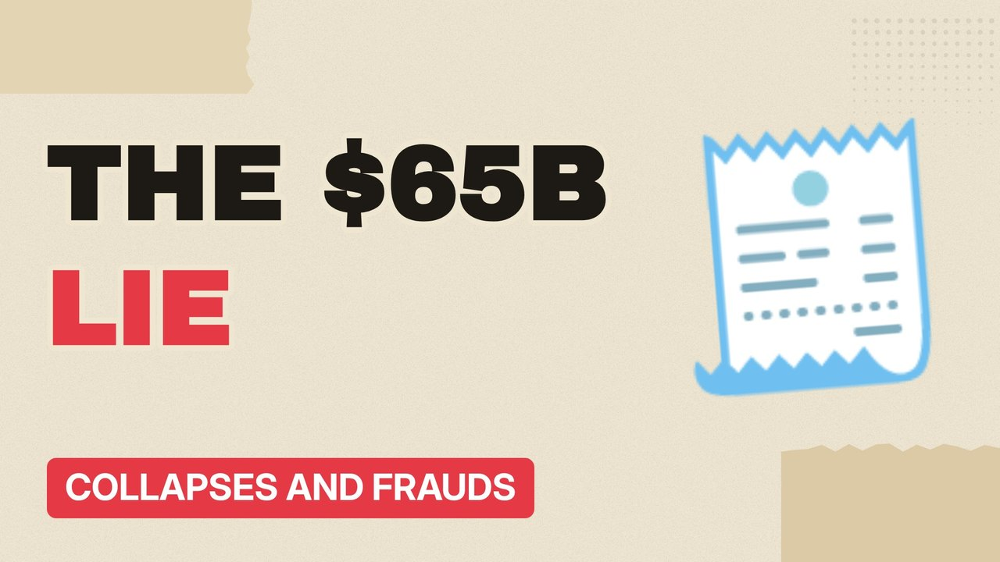

# MV038 · Bernie Madoff: The $65 Billion Lie



## Paste this to Claude

```
Make video MV038 from my idea bank: write and fact-check the full 5+ minute script, render it in its style, and send it to me.
```

**Category:** Collapses and frauds  
**Editing style:** Paper collage. Cream paper, torn cut-outs, red marker colours and heavy type. Each new scene slaps down like a card on a table.  
**Length:** 6 to 8 minutes (about 1,000 to 1,300 words)

## Hook (first line)

> The biggest Ponzi scheme in history was run by a former chairman of a stock exchange.

## Outline

1. Steady returns that never wobbled
2. The man who warned regulators
3. Feeder funds
4. The 2008 crash
5. His sons turn him in
6. Getting the money back

## YouTube title

Bernie Madoff: The $65 Billion Lie

## YouTube description

```
The biggest Ponzi scheme in history was run by a former chairman of a stock exchange.

In this video:
- Steady returns that never wobbled
- The man who warned regulators
- Feeder funds
- The 2008 crash
- His sons turn him in
- Getting the money back

Sources are listed here once the script has been fact-checked.
This video is for education and entertainment only and is not financial advice.

#money #corporatefraud #companycollapse
```

## Tags

corporate fraud, company collapse, finance documentary, bernie madoff, bernie, madoff, billion, money explained

## Facts to check before scripting

- Paper losses vs actual cash lost
- Recovery figures
- Year (2008)

## Script approach

Script formula: the hook is the first sentence (no intro), then 4 to 6 chapters, each opening with a question the viewer wants answered. Keep sentences short and spoken. Close every chapter with a mini-cliffhanger into the next, and end on a one-line takeaway.
