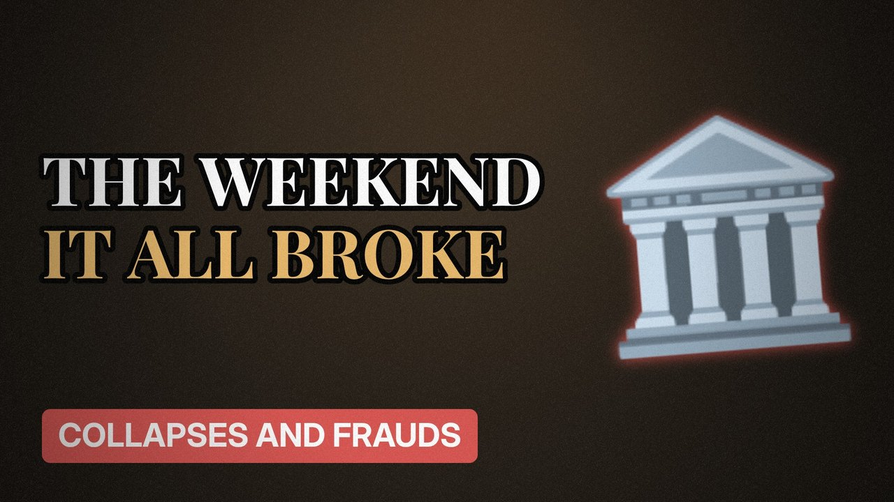

# MV039 · Lehman Brothers: The Weekend That Broke the World



## Paste this to Claude

```
Make video MV039 from my idea bank: write and fact-check the full 5+ minute script, render it in its style, and send it to me.
```

**Category:** Collapses and frauds  
**Editing style:** Archive documentary. Film grain, letterbox bars, serif type, newspaper cuttings and maps. The camera pans sideways from one moment to the next instead of cutting.  
**Length:** 6 to 8 minutes (about 1,000 to 1,300 words)

## Hook (first line)

> In September 2008 a 158-year-old bank failed in a weekend, and the world economy nearly went with it.

## Outline

1. Mortgages nobody could repay
2. Borrowing 30 times its money
3. The weekend talks
4. Why no one saved Lehman
5. The global panic
6. What changed afterwards

## YouTube title

Lehman Brothers: The Weekend That Broke the World

## YouTube description

```
In September 2008 a 158-year-old bank failed in a weekend, and the world economy nearly went with it.

In this video:
- Mortgages nobody could repay
- Borrowing 30 times its money
- The weekend talks
- Why no one saved Lehman
- The global panic
- What changed afterwards

Sources are listed here once the script has been fact-checked.
This video is for education and entertainment only and is not financial advice.

#money #corporatefraud #companycollapse
```

## Tags

corporate fraud, company collapse, finance documentary, lehman brothers, lehman, brothers, weekend, that, money explained

## Facts to check before scripting

- Bank age at collapse
- Size of bankruptcy
- Leverage ratio

## Script approach

Script formula: the hook is the first sentence (no intro), then 4 to 6 chapters, each opening with a question the viewer wants answered. Keep sentences short and spoken. Close every chapter with a mini-cliffhanger into the next, and end on a one-line takeaway.
