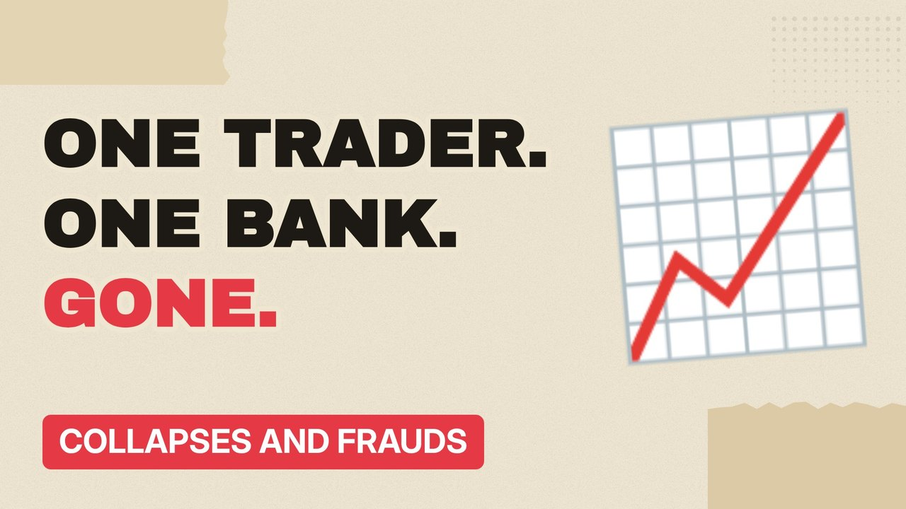

# MV040 · Barings: The Trader Who Sank a 233-Year-Old Bank



## Paste this to Claude

```
Make video MV040 from my idea bank: write and fact-check the full 5+ minute script, render it in its style, and send it to me.
```

**Category:** Collapses and frauds  
**Editing style:** Paper collage. Cream paper, torn cut-outs, red marker colours and heavy type. Each new scene slaps down like a card on a table.  
**Length:** 6 to 8 minutes (about 1,000 to 1,300 words)

## Hook (first line)

> One trader in Singapore hid losses so big they destroyed Britain's oldest merchant bank.

## Outline

1. Barings' history
2. Nick Leeson's job
3. Error account 88888
4. The Kobe earthquake
5. The note: I'm sorry
6. Sold for £1

## YouTube title

Barings: The Trader Who Sank a 233-Year-Old Bank

## YouTube description

```
One trader in Singapore hid losses so big they destroyed Britain's oldest merchant bank.

In this video:
- Barings' history
- Nick Leeson's job
- Error account 88888
- The Kobe earthquake
- The note: I'm sorry
- Sold for £1

Sources are listed here once the script has been fact-checked.
This video is for education and entertainment only and is not financial advice.

#money #corporatefraud #companycollapse
```

## Tags

corporate fraud, company collapse, finance documentary, barings, trader, sank, year, money explained

## Facts to check before scripting

- Losses (£827m)
- Year (1995)
- Sale price to ING

## Script approach

Script formula: the hook is the first sentence (no intro), then 4 to 6 chapters, each opening with a question the viewer wants answered. Keep sentences short and spoken. Close every chapter with a mini-cliffhanger into the next, and end on a one-line takeaway.
