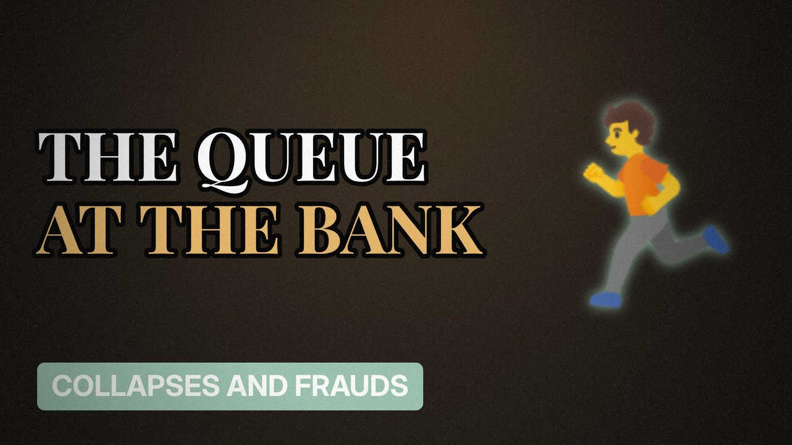

# MV041 · Northern Rock: Britain's First Bank Run in 150 Years



## Paste this to Claude

```
Make video MV041 from my idea bank: write and fact-check the full 5+ minute script, render it in its style, and send it to me.
```

**Category:** Collapses and frauds  
**Editing style:** Archive documentary. Film grain, letterbox bars, serif type, newspaper cuttings and maps. The camera pans sideways from one moment to the next instead of cutting.  
**Length:** 6 to 8 minutes (about 1,000 to 1,300 words)

## Hook (first line)

> In 2007 people queued outside a British bank to take their money out, for the first time in over a century.

## Outline

1. Borrowing short to lend long
2. The 125% mortgage
3. Money markets freeze
4. The queues
5. Nationalisation
6. How your savings are protected now

## YouTube title

Northern Rock: Britain's First Bank Run in 150 Years

## YouTube description

```
In 2007 people queued outside a British bank to take their money out, for the first time in over a century.

In this video:
- Borrowing short to lend long
- The 125% mortgage
- Money markets freeze
- The queues
- Nationalisation
- How your savings are protected now

Sources are listed here once the script has been fact-checked.
This video is for education and entertainment only and is not financial advice.

#money #corporatefraud #companycollapse
```

## Tags

corporate fraud, company collapse, finance documentary, northern rock, northern, rock, britain's, first, money explained

## Facts to check before scripting

- Last UK bank run before it
- Deposit protection limit now (FSCS)

## Script approach

Script formula: the hook is the first sentence (no intro), then 4 to 6 chapters, each opening with a question the viewer wants answered. Keep sentences short and spoken. Close every chapter with a mini-cliffhanger into the next, and end on a one-line takeaway.
