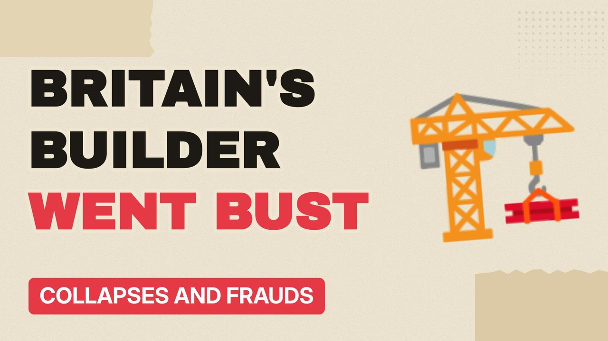

# MV042 · Carillion: The Company That Ran Britain, Then Collapsed



## Paste this to Claude

```
Make video MV042 from my idea bank: write and fact-check the full 5+ minute script, render it in its style, and send it to me.
```

**Category:** Collapses and frauds  
**Editing style:** Paper collage. Cream paper, torn cut-outs, red marker colours and heavy type. Each new scene slaps down like a card on a table.  
**Length:** 6 to 8 minutes (about 1,000 to 1,300 words)

## Hook (first line)

> It built hospitals and cleaned schools, and in 2018 it went bust owing well over a billion pounds.

## Outline

1. What Carillion did
2. Winning contracts at low prices
3. Paying suppliers late
4. Dividends and bonuses
5. The collapse
6. Who picked up the bill

## YouTube title

Carillion: The Company That Ran Britain, Then Collapsed

## YouTube description

```
It built hospitals and cleaned schools, and in 2018 it went bust owing well over a billion pounds.

In this video:
- What Carillion did
- Winning contracts at low prices
- Paying suppliers late
- Dividends and bonuses
- The collapse
- Who picked up the bill

Sources are listed here once the script has been fact-checked.
This video is for education and entertainment only and is not financial advice.

#money #corporatefraud #companycollapse
```

## Tags

corporate fraud, company collapse, finance documentary, carillion, company, that, britain, money explained

## Facts to check before scripting

- Debts at collapse
- Number of jobs
- Parliament report findings

## Script approach

Script formula: the hook is the first sentence (no intro), then 4 to 6 chapters, each opening with a question the viewer wants answered. Keep sentences short and spoken. Close every chapter with a mini-cliffhanger into the next, and end on a one-line takeaway.
