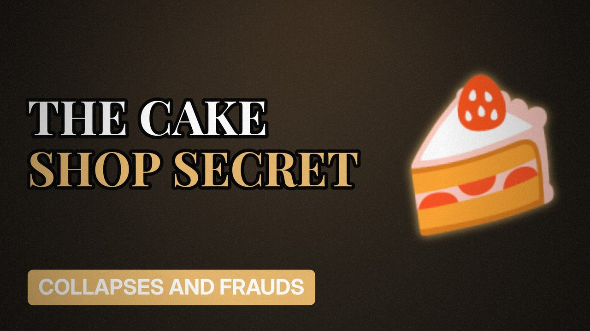

# MV043 · Patisserie Valerie: The Cake Shop With a Hidden Hole



## Paste this to Claude

```
Make video MV043 from my idea bank: write and fact-check the full 5+ minute script, render it in its style, and send it to me.
```

**Category:** Collapses and frauds  
**Editing style:** Archive documentary. Film grain, letterbox bars, serif type, newspaper cuttings and maps. The camera pans sideways from one moment to the next instead of cutting.  
**Length:** 6 to 8 minutes (about 1,000 to 1,300 words)

## Hook (first line)

> A much-loved café chain discovered its accounts were hiding tens of millions of pounds of problems.

## Outline

1. The cake shop boom
2. The accounting black hole
3. The overdrafts no one knew about
4. Shares suspended
5. Administration
6. What happened to the shops

## YouTube title

Patisserie Valerie: The Cake Shop With a Hidden Hole

## YouTube description

```
A much-loved café chain discovered its accounts were hiding tens of millions of pounds of problems.

In this video:
- The cake shop boom
- The accounting black hole
- The overdrafts no one knew about
- Shares suspended
- Administration
- What happened to the shops

Sources are listed here once the script has been fact-checked.
This video is for education and entertainment only and is not financial advice.

#money #corporatefraud #companycollapse
```

## Tags

corporate fraud, company collapse, finance documentary, patisserie valerie, patisserie, valerie, cake, shop, money explained

## Facts to check before scripting

- Size of the accounting gap
- Year (2018)
- Outcome of investigations (check latest)

## Script approach

Script formula: the hook is the first sentence (no intro), then 4 to 6 chapters, each opening with a question the viewer wants answered. Keep sentences short and spoken. Close every chapter with a mini-cliffhanger into the next, and end on a one-line takeaway.
