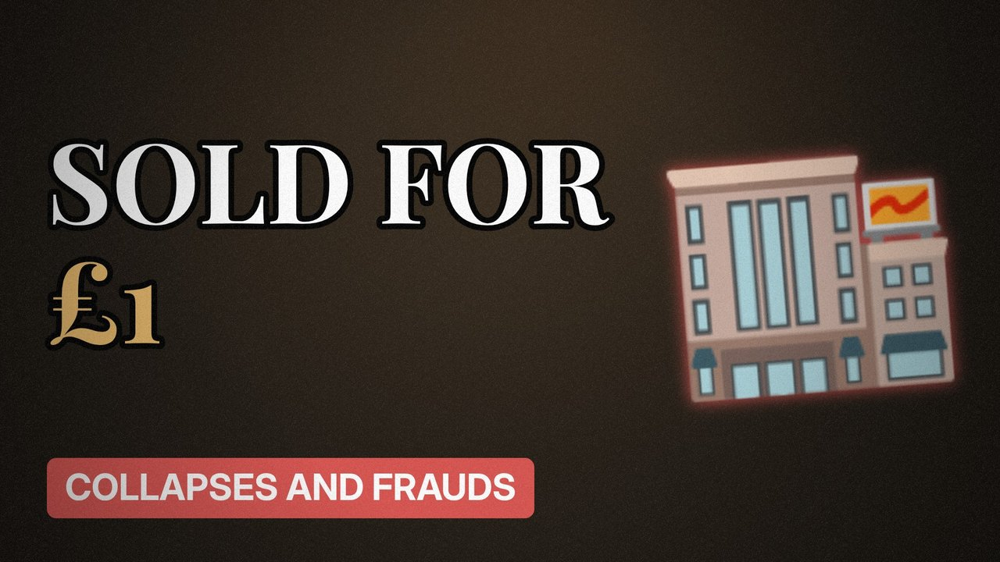

# MV045 · BHS: The Shop Sold for £1



## Paste this to Claude

```
Make video MV045 from my idea bank: write and fact-check the full 5+ minute script, render it in its style, and send it to me.
```

**Category:** Collapses and frauds  
**Editing style:** Archive documentary. Film grain, letterbox bars, serif type, newspaper cuttings and maps. The camera pans sideways from one moment to the next instead of cutting.  
**Length:** 6 to 8 minutes (about 1,000 to 1,300 words)

## Hook (first line)

> A famous British department store chain was sold for a single pound, and collapsed a year later.

## Outline

1. BHS in its prime
2. The £1 sale
3. The pension hole
4. Collapse in 2016
5. Thousands of jobs lost
6. What MPs concluded

## YouTube title

BHS: The Shop Sold for £1

## YouTube description

```
A famous British department store chain was sold for a single pound, and collapsed a year later.

In this video:
- BHS in its prime
- The £1 sale
- The pension hole
- Collapse in 2016
- Thousands of jobs lost
- What MPs concluded

Sources are listed here once the script has been fact-checked.
This video is for education and entertainment only and is not financial advice.

#money #corporatefraud #companycollapse
```

## Tags

corporate fraud, company collapse, finance documentary, bhs, shop, sold, money explained

## Facts to check before scripting

- Sale price and date
- Pension deficit figure
- Jobs lost

## Script approach

Script formula: the hook is the first sentence (no intro), then 4 to 6 chapters, each opening with a question the viewer wants answered. Keep sentences short and spoken. Close every chapter with a mini-cliffhanger into the next, and end on a one-line takeaway.
