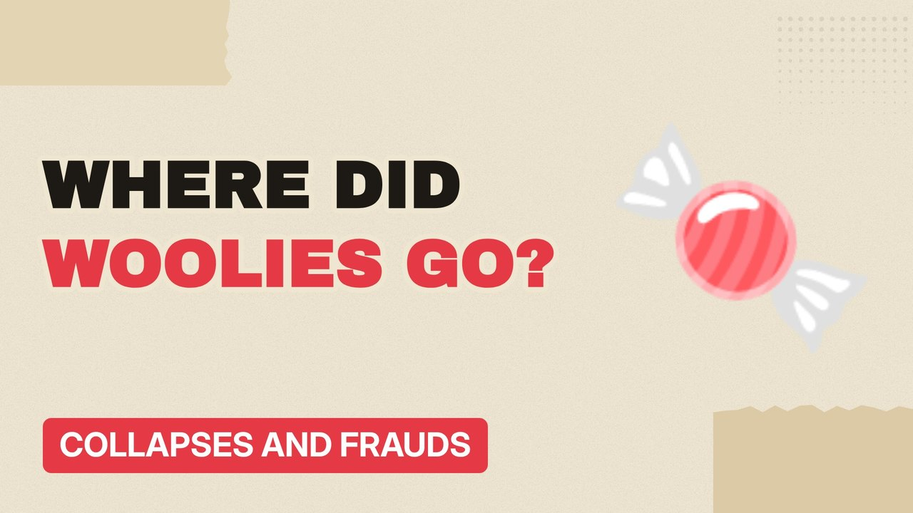

# MV046 · Woolworths: Why Britain's Favourite Shop Disappeared



## Paste this to Claude

```
Make video MV046 from my idea bank: write and fact-check the full 5+ minute script, render it in its style, and send it to me.
```

**Category:** Collapses and frauds  
**Editing style:** Paper collage. Cream paper, torn cut-outs, red marker colours and heavy type. Each new scene slaps down like a card on a table.  
**Length:** 6 to 8 minutes (about 1,000 to 1,300 words)

## Hook (first line)

> Woolworths was on almost every high street in Britain, and it vanished within weeks.

## Outline

1. Pick 'n' mix and everything else
2. Squeezed by supermarkets and online
3. The property sale that hurt
4. The 2008 crash
5. Closing down sales
6. Where the shops went

## YouTube title

Woolworths: Why Britain's Favourite Shop Disappeared

## YouTube description

```
Woolworths was on almost every high street in Britain, and it vanished within weeks.

In this video:
- Pick 'n' mix and everything else
- Squeezed by supermarkets and online
- The property sale that hurt
- The 2008 crash
- Closing down sales
- Where the shops went

Sources are listed here once the script has been fact-checked.
This video is for education and entertainment only and is not financial advice.

#money #corporatefraud #companycollapse
```

## Tags

corporate fraud, company collapse, finance documentary, woolworths, britain's, favourite, shop, money explained

## Facts to check before scripting

- Number of shops and closure year
- Sale-and-leaseback details

## Script approach

Script formula: the hook is the first sentence (no intro), then 4 to 6 chapters, each opening with a question the viewer wants answered. Keep sentences short and spoken. Close every chapter with a mini-cliffhanger into the next, and end on a one-line takeaway.
