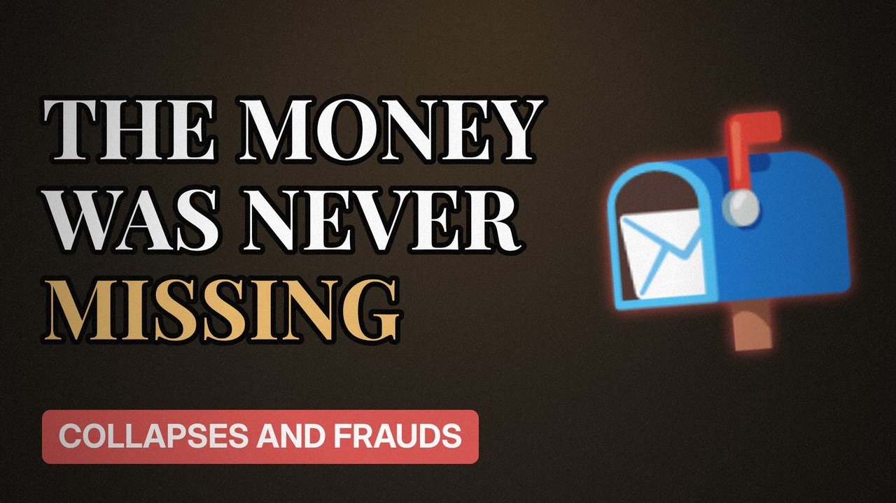

# MV047 · The Post Office Scandal: How Faulty Software Ruined Lives



## Paste this to Claude

```
Make video MV047 from my idea bank: write and fact-check the full 5+ minute script, render it in its style, and send it to me.
```

**Category:** Collapses and frauds  
**Editing style:** Archive documentary. Film grain, letterbox bars, serif type, newspaper cuttings and maps. The camera pans sideways from one moment to the next instead of cutting.  
**Length:** 6 to 8 minutes (about 1,000 to 1,300 words)

## Hook (first line)

> Hundreds of postmasters were blamed for missing money that a computer system had wrongly shown.

## Outline

1. What Horizon was
2. Shortfalls that weren't real
3. Prosecutions
4. The fight for the truth
5. The court ruling
6. Compensation and the inquiry

## YouTube title

The Post Office Scandal: How Faulty Software Ruined Lives

## YouTube description

```
Hundreds of postmasters were blamed for missing money that a computer system had wrongly shown.

In this video:
- What Horizon was
- Shortfalls that weren't real
- Prosecutions
- The fight for the truth
- The court ruling
- Compensation and the inquiry

Sources are listed here once the script has been fact-checked.
This video is for education and entertainment only and is not financial advice.

#money #corporatefraud #companycollapse
```

## Tags

corporate fraud, company collapse, finance documentary, the post office scandal, post, office, scandal, faulty, money explained

## Facts to check before scripting

- Number of convictions
- Key court judgment year
- Compensation status (check latest)

## Script approach

Script formula: the hook is the first sentence (no intro), then 4 to 6 chapters, each opening with a question the viewer wants answered. Keep sentences short and spoken. Close every chapter with a mini-cliffhanger into the next, and end on a one-line takeaway.
