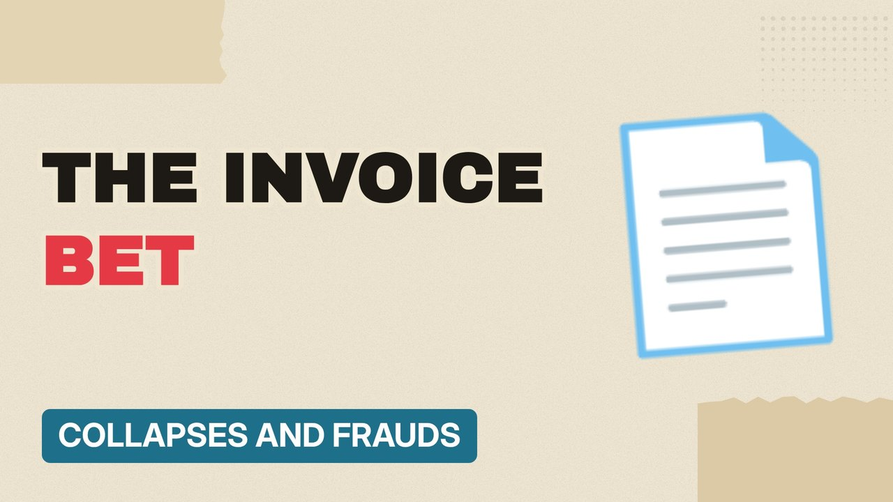

# MV048 · Greensill: The Billion-Pound Bet That Collapsed



## Paste this to Claude

```
Make video MV048 from my idea bank: write and fact-check the full 5+ minute script, render it in its style, and send it to me.
```

**Category:** Collapses and frauds  
**Editing style:** Paper collage. Cream paper, torn cut-outs, red marker colours and heavy type. Each new scene slaps down like a card on a table.  
**Length:** 6 to 8 minutes (about 1,000 to 1,300 words)

## Hook (first line)

> A finance firm that lent against future invoices collapsed in 2021, and pulled big names into the story.

## Outline

1. Supply chain finance explained
2. Fast growth
3. Insurance that ran out
4. Collapse
5. The fallout
6. What went wrong

## YouTube title

Greensill: The Billion-Pound Bet That Collapsed

## YouTube description

```
A finance firm that lent against future invoices collapsed in 2021, and pulled big names into the story.

In this video:
- Supply chain finance explained
- Fast growth
- Insurance that ran out
- Collapse
- The fallout
- What went wrong

Sources are listed here once the script has been fact-checked.
This video is for education and entertainment only and is not financial advice.

#money #corporatefraud #companycollapse
```

## Tags

corporate fraud, company collapse, finance documentary, greensill, billion, pound, that, money explained

## Facts to check before scripting

- Year (2021)
- Key facts from official reports (stay factual and neutral)

## Script approach

Script formula: the hook is the first sentence (no intro), then 4 to 6 chapters, each opening with a question the viewer wants answered. Keep sentences short and spoken. Close every chapter with a mini-cliffhanger into the next, and end on a one-line takeaway.
