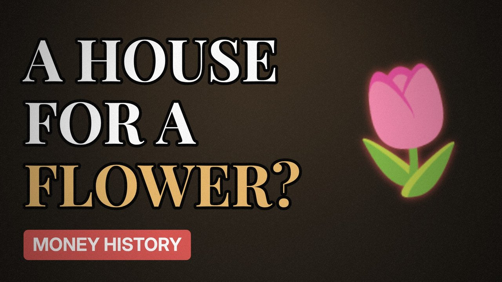

# MV049 · Tulip Mania: Did People Really Pay a House for a Flower?



## Paste this to Claude

```
Make video MV049 from my idea bank: write and fact-check the full 5+ minute script, render it in its style, and send it to me.
```

**Category:** Money history  
**Editing style:** Archive documentary. Film grain, letterbox bars, serif type, newspaper cuttings and maps. The camera pans sideways from one moment to the next instead of cutting.  
**Length:** 6 to 8 minutes (about 1,000 to 1,300 words)

## Hook (first line)

> In 1637 a single tulip bulb was said to be worth as much as a house. The truth is stranger.

## Outline

1. Tulips arrive in the Netherlands
2. Broken tulips and rare colours
3. Trading in taverns
4. The crash
5. The myth vs the evidence
6. Why we still tell the story

## YouTube title

Tulip Mania: Did People Really Pay a House for a Flower?

## YouTube description

```
In 1637 a single tulip bulb was said to be worth as much as a house. The truth is stranger.

In this video:
- Tulips arrive in the Netherlands
- Broken tulips and rare colours
- Trading in taverns
- The crash
- The myth vs the evidence
- Why we still tell the story

Sources are listed here once the script has been fact-checked.
This video is for education and entertainment only and is not financial advice.

#money #historyofmoney #economichistory
```

## Tags

history of money, economic history, financial history, tulip mania, tulip, mania, people, really, money explained

## Facts to check before scripting

- Prices quoted for rare bulbs
- What historians say about how bad the crash was

## Script approach

Script formula: the hook is the first sentence (no intro), then 4 to 6 chapters, each opening with a question the viewer wants answered. Keep sentences short and spoken. Close every chapter with a mini-cliffhanger into the next, and end on a one-line takeaway.
