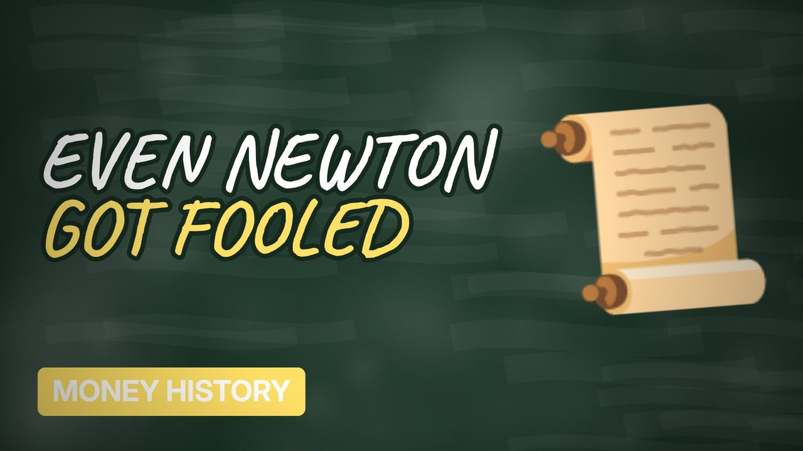

# MV050 · The South Sea Bubble: How Isaac Newton Lost a Fortune



## Paste this to Claude

```
Make video MV050 from my idea bank: write and fact-check the full 5+ minute script, render it in its style, and send it to me.
```

**Category:** Money history  
**Editing style:** Blackboard. A chalkboard in a wooden frame with handwritten text. Scenes change with an eraser wipe, like a teacher explaining on the board.  
**Length:** 6 to 8 minutes (about 1,000 to 1,300 words)

## Hook (first line)

> One of the smartest people who ever lived lost a fortune in a stock market bubble.

## Outline

1. The South Sea Company
2. Trading on hype
3. Newton sells, then buys back
4. Bubble companies
5. The crash of 1720
6. Lessons for today

## YouTube title

The South Sea Bubble: How Isaac Newton Lost a Fortune

## YouTube description

```
One of the smartest people who ever lived lost a fortune in a stock market bubble.

In this video:
- The South Sea Company
- Trading on hype
- Newton sells, then buys back
- Bubble companies
- The crash of 1720
- Lessons for today

Sources are listed here once the script has been fact-checked.
This video is for education and entertainment only and is not financial advice.

#money #historyofmoney #economichistory
```

## Tags

history of money, economic history, financial history, the south sea bubble, south, bubble, isaac, newton, money explained

## Facts to check before scripting

- Newton's estimated losses
- Share price peak and fall

## Script approach

Script formula: the hook is the first sentence (no intro), then 4 to 6 chapters, each opening with a question the viewer wants answered. Keep sentences short and spoken. Close every chapter with a mini-cliffhanger into the next, and end on a one-line takeaway.
