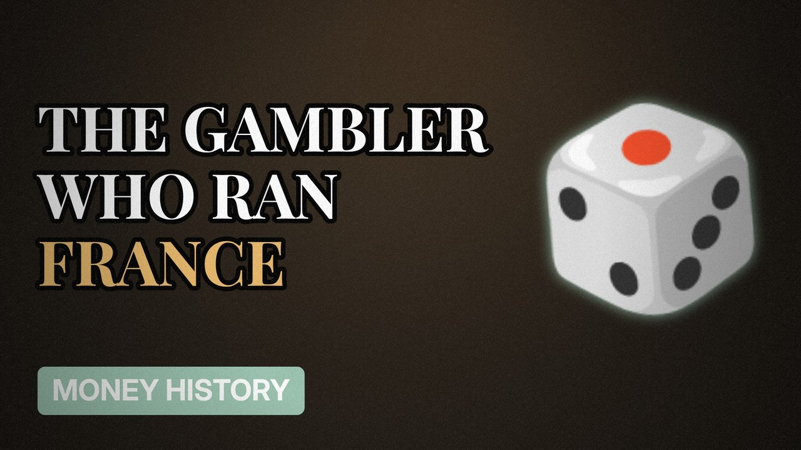

# MV051 · John Law: The Gambler Who Ran France's Money



## Paste this to Claude

```
Make video MV051 from my idea bank: write and fact-check the full 5+ minute script, render it in its style, and send it to me.
```

**Category:** Money history  
**Editing style:** Archive documentary. Film grain, letterbox bars, serif type, newspaper cuttings and maps. The camera pans sideways from one moment to the next instead of cutting.  
**Length:** 6 to 8 minutes (about 1,000 to 1,300 words)

## Hook (first line)

> A Scottish gambler convinced France to let him run its money, and nearly broke the country.

## Outline

1. Gambler and duellist
2. Paper money in France
3. The Mississippi Company
4. The bubble
5. The collapse
6. His legacy

## YouTube title

John Law: The Gambler Who Ran France's Money

## YouTube description

```
A Scottish gambler convinced France to let him run its money, and nearly broke the country.

In this video:
- Gambler and duellist
- Paper money in France
- The Mississippi Company
- The bubble
- The collapse
- His legacy

Sources are listed here once the script has been fact-checked.
This video is for education and entertainment only and is not financial advice.

#money #historyofmoney #economichistory
```

## Tags

history of money, economic history, financial history, john law, john, gambler, france's, money, money explained

## Facts to check before scripting

- Years (1716 to 1720)
- Key events of the Mississippi bubble

## Script approach

Script formula: the hook is the first sentence (no intro), then 4 to 6 chapters, each opening with a question the viewer wants answered. Keep sentences short and spoken. Close every chapter with a mini-cliffhanger into the next, and end on a one-line takeaway.
