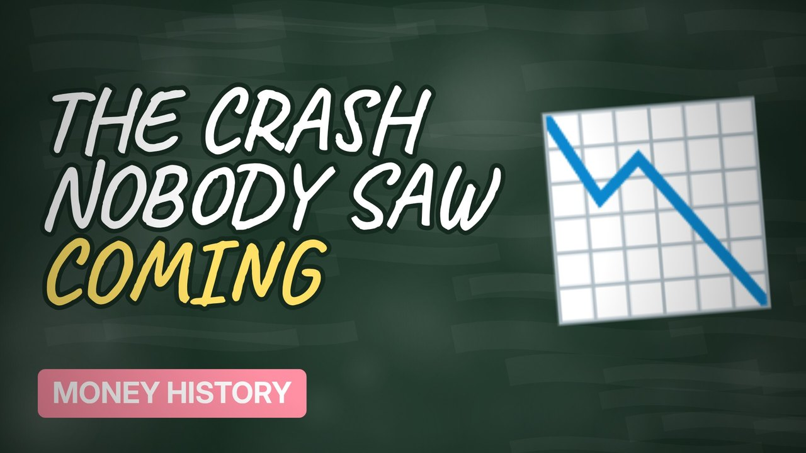

# MV052 · The 1929 Crash: When Everyone Thought Stocks Only Went Up



## Paste this to Claude

```
Make video MV052 from my idea bank: write and fact-check the full 5+ minute script, render it in its style, and send it to me.
```

**Category:** Money history  
**Editing style:** Blackboard. A chalkboard in a wooden frame with handwritten text. Scenes change with an eraser wipe, like a teacher explaining on the board.  
**Length:** 6 to 8 minutes (about 1,000 to 1,300 words)

## Hook (first line)

> In 1929 people borrowed money to buy shares, until the market fell and kept on falling.

## Outline

1. The roaring twenties
2. Buying on margin
3. Black Thursday and Black Tuesday
4. Banks fail
5. The Great Depression
6. How long it took to recover

## YouTube title

The 1929 Crash: When Everyone Thought Stocks Only Went Up

## YouTube description

```
In 1929 people borrowed money to buy shares, until the market fell and kept on falling.

In this video:
- The roaring twenties
- Buying on margin
- Black Thursday and Black Tuesday
- Banks fail
- The Great Depression
- How long it took to recover

Sources are listed here once the script has been fact-checked.
This video is for education and entertainment only and is not financial advice.

#money #historyofmoney #economichistory
```

## Tags

history of money, economic history, financial history, the 1929 crash, 1929, crash, when, everyone, money explained

## Facts to check before scripting

- Dates of the crash
- Peak-to-bottom fall of the Dow
- Years to recover

## Script approach

Script formula: the hook is the first sentence (no intro), then 4 to 6 chapters, each opening with a question the viewer wants answered. Keep sentences short and spoken. Close every chapter with a mini-cliffhanger into the next, and end on a one-line takeaway.
