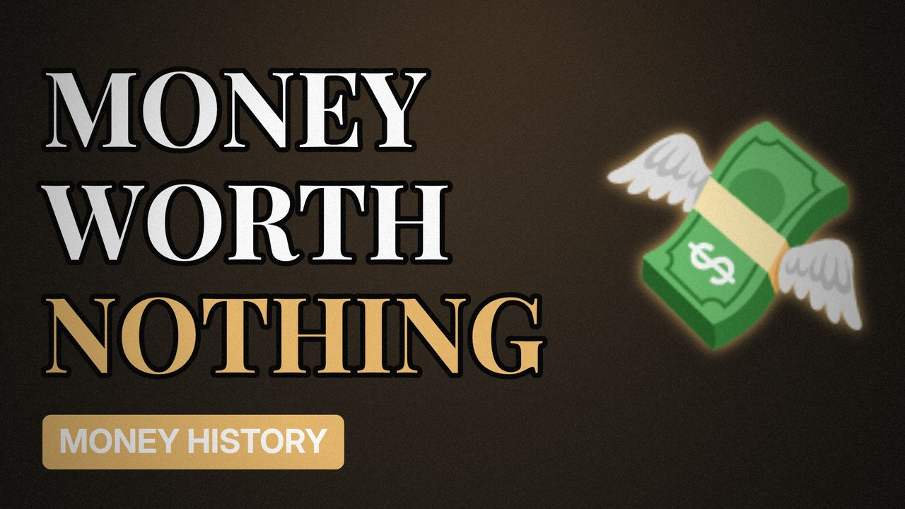

# MV053 · Weimar Germany: When Money Was Cheaper Than Wallpaper



## Paste this to Claude

```
Make video MV053 from my idea bank: write and fact-check the full 5+ minute script, render it in its style, and send it to me.
```

**Category:** Money history  
**Editing style:** Archive documentary. Film grain, letterbox bars, serif type, newspaper cuttings and maps. The camera pans sideways from one moment to the next instead of cutting.  
**Length:** 6 to 8 minutes (about 1,000 to 1,300 words)

## Hook (first line)

> In 1923 German prices doubled every few days, and people burned money because it was cheaper than wood.

## Outline

1. War debts and reparations
2. Printing money
3. Prices out of control
4. Wheelbarrows of cash
5. The new currency
6. What it led to

## YouTube title

Weimar Germany: When Money Was Cheaper Than Wallpaper

## YouTube description

```
In 1923 German prices doubled every few days, and people burned money because it was cheaper than wood.

In this video:
- War debts and reparations
- Printing money
- Prices out of control
- Wheelbarrows of cash
- The new currency
- What it led to

Sources are listed here once the script has been fact-checked.
This video is for education and entertainment only and is not financial advice.

#money #historyofmoney #economichistory
```

## Tags

history of money, economic history, financial history, weimar germany, weimar, germany, when, money, money explained

## Facts to check before scripting

- Peak inflation figure
- Exchange rate to the dollar in late 1923

## Script approach

Script formula: the hook is the first sentence (no intro), then 4 to 6 chapters, each opening with a question the viewer wants answered. Keep sentences short and spoken. Close every chapter with a mini-cliffhanger into the next, and end on a one-line takeaway.
