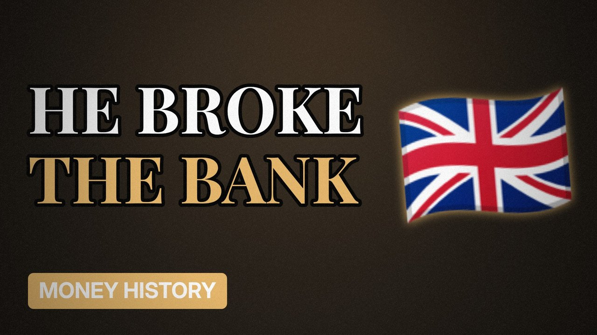

# MV055 · Black Wednesday: The Day One Man Beat the Bank of England



## Paste this to Claude

```
Make video MV055 from my idea bank: write and fact-check the full 5+ minute script, render it in its style, and send it to me.
```

**Category:** Money history  
**Editing style:** Archive documentary. Film grain, letterbox bars, serif type, newspaper cuttings and maps. The camera pans sideways from one moment to the next instead of cutting.  
**Length:** 6 to 8 minutes (about 1,000 to 1,300 words)

## Hook (first line)

> In 1992 an investor bet billions against the pound and the Bank of England lost.

## Outline

1. The European exchange rate system
2. Why the pound was too high
3. Interest rates raised twice in a day
4. The bet against the pound
5. Britain crashes out
6. Who won and who lost

## YouTube title

Black Wednesday: The Day One Man Beat the Bank of England

## YouTube description

```
In 1992 an investor bet billions against the pound and the Bank of England lost.

In this video:
- The European exchange rate system
- Why the pound was too high
- Interest rates raised twice in a day
- The bet against the pound
- Britain crashes out
- Who won and who lost

Sources are listed here once the script has been fact-checked.
This video is for education and entertainment only and is not financial advice.

#money #historyofmoney #economichistory
```

## Tags

history of money, economic history, financial history, black wednesday, black, wednesday, beat, bank, money explained

## Facts to check before scripting

- Date (16 September 1992)
- Estimated profit made
- Interest rate moves that day

## Script approach

Script formula: the hook is the first sentence (no intro), then 4 to 6 chapters, each opening with a question the viewer wants answered. Keep sentences short and spoken. Close every chapter with a mini-cliffhanger into the next, and end on a one-line takeaway.
