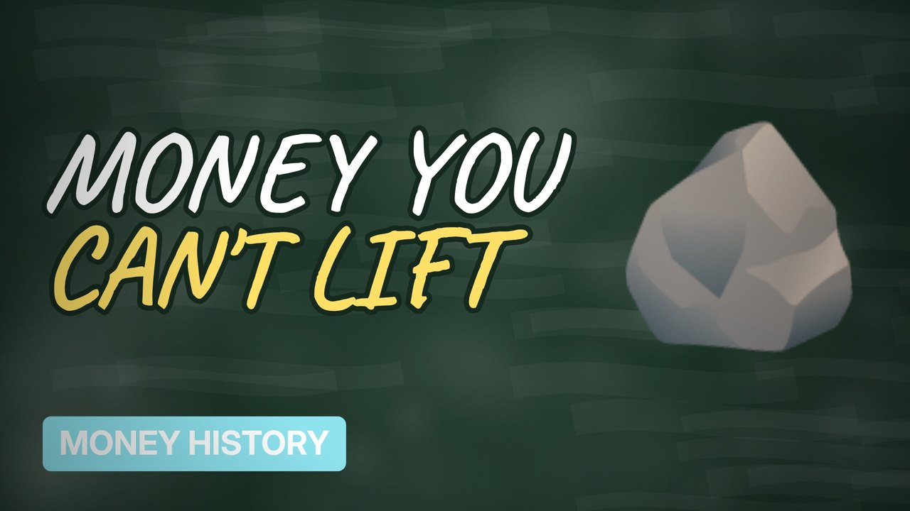

# MV056 · The Island Where Money Is Giant Stones



## Paste this to Claude

```
Make video MV056 from my idea bank: write and fact-check the full 5+ minute script, render it in its style, and send it to me.
```

**Category:** Money history  
**Editing style:** Blackboard. A chalkboard in a wooden frame with handwritten text. Scenes change with an eraser wipe, like a teacher explaining on the board.  
**Length:** 6 to 8 minutes (about 1,000 to 1,300 words)

## Hook (first line)

> On the island of Yap, money can be a stone too heavy to move, and it still works.

## Outline

1. The rai stones
2. Sailing to quarry them
3. Ownership without moving them
4. The stone at the bottom of the sea
5. What it teaches us about money
6. Bitcoin comparisons

## YouTube title

The Island Where Money Is Giant Stones

## YouTube description

```
On the island of Yap, money can be a stone too heavy to move, and it still works.

In this video:
- The rai stones
- Sailing to quarry them
- Ownership without moving them
- The stone at the bottom of the sea
- What it teaches us about money
- Bitcoin comparisons

Sources are listed here once the script has been fact-checked.
This video is for education and entertainment only and is not financial advice.

#money #historyofmoney #economichistory
```

## Tags

history of money, economic history, financial history, the island where money is giant stones, island, where, money, giant, money explained

## Facts to check before scripting

- Stone sizes
- Where they were quarried (Palau)

## Script approach

Script formula: the hook is the first sentence (no intro), then 4 to 6 chapters, each opening with a question the viewer wants answered. Keep sentences short and spoken. Close every chapter with a mini-cliffhanger into the next, and end on a one-line takeaway.
