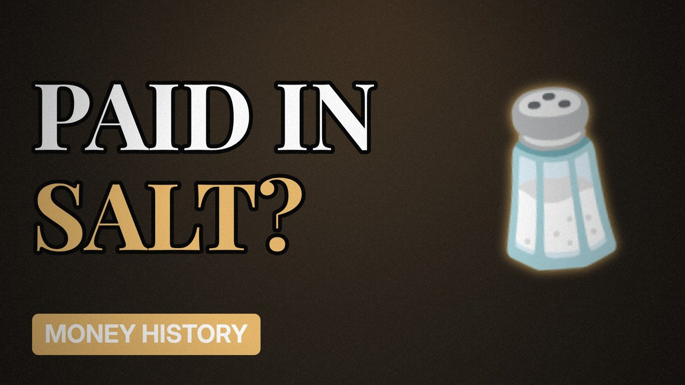

# MV057 · Were Roman Soldiers Really Paid in Salt?



## Paste this to Claude

```
Make video MV057 from my idea bank: write and fact-check the full 5+ minute script, render it in its style, and send it to me.
```

**Category:** Money history  
**Editing style:** Archive documentary. Film grain, letterbox bars, serif type, newspaper cuttings and maps. The camera pans sideways from one moment to the next instead of cutting.  
**Length:** 6 to 8 minutes (about 1,000 to 1,300 words)

## Hook (first line)

> You've probably heard that 'salary' comes from Romans being paid in salt. The real story is messier.

## Outline

1. The salary story
2. Why salt was valuable
3. What historians actually say
4. How Roman soldiers were paid
5. Other myths about money
6. Why myths stick

## YouTube title

Were Roman Soldiers Really Paid in Salt?

## YouTube description

```
You've probably heard that 'salary' comes from Romans being paid in salt. The real story is messier.

In this video:
- The salary story
- Why salt was valuable
- What historians actually say
- How Roman soldiers were paid
- Other myths about money
- Why myths stick

Sources are listed here once the script has been fact-checked.
This video is for education and entertainment only and is not financial advice.

#money #historyofmoney #economichistory
```

## Tags

history of money, economic history, financial history, were roman soldiers really paid in salt?, were, roman, soldiers, really, money explained

## Facts to check before scripting

- Historians' view on the salarium myth

## Script approach

Script formula: the hook is the first sentence (no intro), then 4 to 6 chapters, each opening with a question the viewer wants answered. Keep sentences short and spoken. Close every chapter with a mini-cliffhanger into the next, and end on a one-line takeaway.
