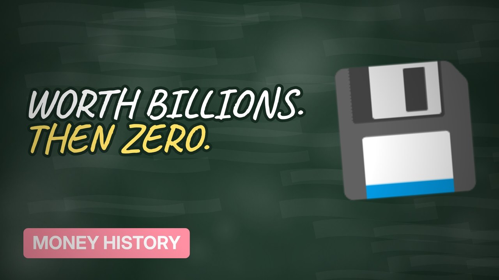

# MV058 · The Dot-Com Bubble: The Companies That Burned Billions



## Paste this to Claude

```
Make video MV058 from my idea bank: write and fact-check the full 5+ minute script, render it in its style, and send it to me.
```

**Category:** Money history  
**Editing style:** Blackboard. A chalkboard in a wooden frame with handwritten text. Scenes change with an eraser wipe, like a teacher explaining on the board.  
**Length:** 6 to 8 minutes (about 1,000 to 1,300 words)

## Hook (first line)

> In 2000 companies with no profits were worth billions, and then they weren't.

## Outline

1. The internet gold rush
2. Pets.com and the sock puppet
3. Clicks instead of profits
4. The crash
5. Who survived
6. Is AI the same?

## YouTube title

The Dot-Com Bubble: The Companies That Burned Billions

## YouTube description

```
In 2000 companies with no profits were worth billions, and then they weren't.

In this video:
- The internet gold rush
- Pets.com and the sock puppet
- Clicks instead of profits
- The crash
- Who survived
- Is AI the same?

Sources are listed here once the script has been fact-checked.
This video is for education and entertainment only and is not financial advice.

#money #historyofmoney #economichistory
```

## Tags

history of money, economic history, financial history, the dot-com bubble, bubble, companies, that, burned, money explained

## Facts to check before scripting

- Nasdaq peak and fall
- Pets.com IPO to collapse timeline

## Script approach

Script formula: the hook is the first sentence (no intro), then 4 to 6 chapters, each opening with a question the viewer wants answered. Keep sentences short and spoken. Close every chapter with a mini-cliffhanger into the next, and end on a one-line takeaway.
