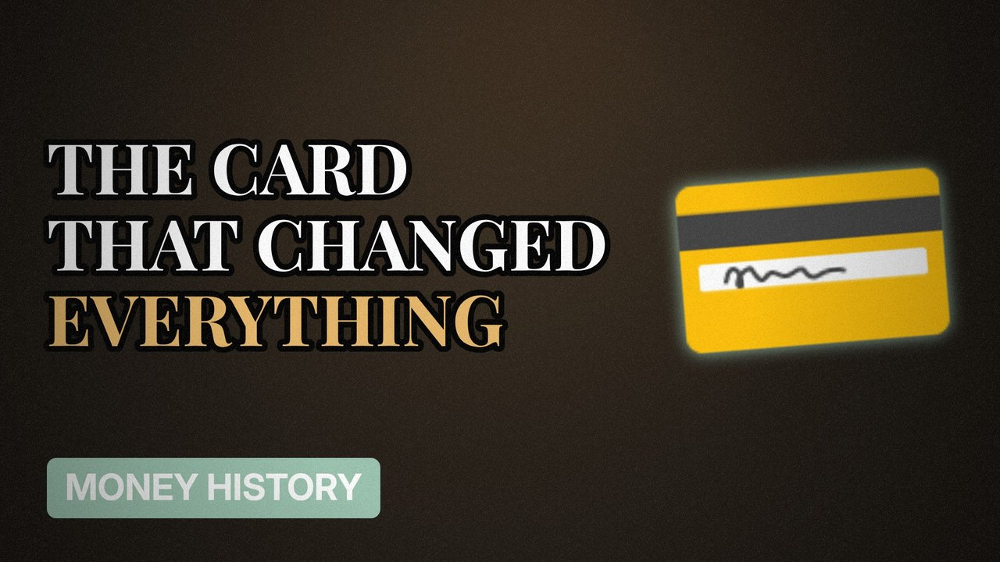

# MV059 · The History of the Credit Card



## Paste this to Claude

```
Make video MV059 from my idea bank: write and fact-check the full 5+ minute script, render it in its style, and send it to me.
```

**Category:** Money history  
**Editing style:** Archive documentary. Film grain, letterbox bars, serif type, newspaper cuttings and maps. The camera pans sideways from one moment to the next instead of cutting.  
**Length:** 6 to 8 minutes (about 1,000 to 1,300 words)

## Hook (first line)

> The credit card started because a man forgot his wallet at dinner, or so the story goes.

## Outline

1. Store cards and charge plates
2. Diners Club
3. Barclaycard, Britain's first
4. Interest and minimum payments
5. Contactless
6. Why they're designed to keep you paying

## YouTube title

The History of the Credit Card

## YouTube description

```
The credit card started because a man forgot his wallet at dinner, or so the story goes.

In this video:
- Store cards and charge plates
- Diners Club
- Barclaycard, Britain's first
- Interest and minimum payments
- Contactless
- Why they're designed to keep you paying

Sources are listed here once the script has been fact-checked.
This video is for education and entertainment only and is not financial advice.

#money #historyofmoney #economichistory
```

## Tags

history of money, economic history, financial history, the history of the credit card, history, credit, card, money explained

## Facts to check before scripting

- Barclaycard launch year (1966)
- Diners Club origin story (and whether it's true)

## Script approach

Script formula: the hook is the first sentence (no intro), then 4 to 6 chapters, each opening with a question the viewer wants answered. Keep sentences short and spoken. Close every chapter with a mini-cliffhanger into the next, and end on a one-line takeaway.
